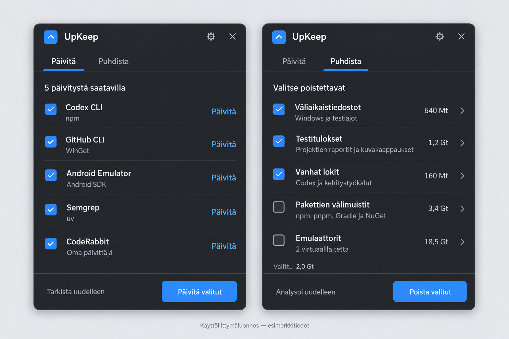

# UpKeep — Project Context and Engineering Reference

**Last checked against local source: 2026-11-01 (Europe/Helsinki).**

**Review baseline:** local branch `codex/initial-review`, HEAD `8887708` (`Korjaa siivouksen virheraportointi ja raporttien luokittelu`), with a clean working tree before this documentation update. This identifies the inspected source, not a newly tested build. Only this document was changed during the review.

UpKeep is a compact, English-language Windows 11 tray application for explicitly requested software updates and reviewed cleanup. It brings several installed package managers, native updaters, project outputs, temporary locations, caches, and Android virtual devices into one small panel. The two main views are **Updates** and **Cleanup**.

This document is intended to be reusable context for code reviews, UI discussions, debugging, implementation questions, and test planning. It describes the current source, explains the product constraints, and identifies evidence boundaries. It is not a claim that every implemented path has been validated on the real desktop.

## Contents

1. [Quick facts](#1-quick-facts)
2. [Sources and interpretation](#2-sources-and-interpretation)
3. [Product scope and non-goals](#3-product-scope-and-non-goals)
4. [User interface and interaction contract](#4-user-interface-and-interaction-contract)
5. [Architecture and source map](#5-architecture-and-source-map)
6. [Update models and execution](#6-update-models-and-execution)
7. [Update provider coverage](#7-update-provider-coverage)
8. [Cleanup discovery and classification](#8-cleanup-discovery-and-classification)
9. [Cleanup execution and managed actions](#9-cleanup-execution-and-managed-actions)
10. [Processes and privilege boundaries](#10-processes-and-privilege-boundaries)
11. [Settings, state, and recovery](#11-settings-state-and-recovery)
12. [Build, test, and distribution](#12-build-test-and-distribution)
13. [Test coverage and verification status](#13-test-coverage-and-verification-status)
14. [Known limitations and specification differences](#14-known-limitations-and-specification-differences)
15. [Code review and UI review guide](#15-code-review-and-ui-review-guide)
16. [Working conventions and maintenance](#16-working-conventions-and-maintenance)

## 1. Quick facts

| Area | Current baseline |
|---|---|
| Product name | UpKeep |
| Application language | English, including app-owned messages and accessibility labels |
| Platform | Windows 11 24H2 or later; x64 |
| Runtime target | `net10.0-windows10.0.26100.0` |
| UI | C# and WinUI 3, with Windows App SDK |
| Window | One compact, borderless, non-resizable tray panel; preferred size 420 × 566 DIPs |
| Main destinations | Updates and Cleanup; settings and details are secondary surfaces |
| Delivery | Unpackaged, self-contained `win-x64` folder; the publish script also creates a ZIP |
| Main process privilege | `asInvoker`; the app does not normally run as administrator |
| Privileged helper | Adjacent `UpKeep.CleanupHost.exe`, started on demand through UAC |
| Runtime storage | `%LOCALAPPDATA%\UpKeep` |
| Project output | `artifacts/` |
| Persistence | Small JSON settings/summary files and temporary JSONL cleanup manifests; no database |
| Test framework | xUnit core/native/provider tests, plus a separate executable WinUI workflow harness; live read-only provider checks are explicitly tagged |
| Networking | Installed managers and the WinGet API may contact configured sources during requested operations |
| Background behavior | The tray process can remain open and finish requested work; no scheduled checks or automatic user maintenance |
| Local version-control state | Git repository; inspected feature branch `codex/initial-review` at `8887708`; configured origin is `https://github.com/Insaner1980/UpKeep.git` |
| Verification boundary | Historical 114- and 203-test runs and WinUI harness reports exist; none is presented as a fresh pass of the reviewed HEAD; no application tests ran for this document |

The exact configured dependencies are listed in [section 12](#12-build-test-and-distribution). These are repository configuration facts, not a statement that those versions are currently the newest available releases.

## 2. Sources and interpretation

Use these local sources together:

| Source | Purpose and authority |
|---|---|
| [README.md](README.md) | Short introduction, basic commands, operational cautions, and earlier verification summary |
| [Original specification and implementation plan](docs/superpowers/plans/2026-10-31-upkeep-implementation-plan.md) | Product intent, approved design, exclusions, implementation tasks, and acceptance requirements |
| [Approved UI reference](docs/design/upkeep-ui-reference.png) | Visual direction; contains illustrative Finnish copy and example data |
| [src](src) | What is actually implemented; use this to verify behavior described here |
| [tests/UpKeep.Tests](tests/UpKeep.Tests) | Executable regression expectations and fixture boundaries |
| [tests/UpKeep.UiTests](tests/UpKeep.UiTests) | WinUI executable linking production window/XAML/platform sources; isolated workflow assertions, not a second product app |
| [Windows-check configuration](tools/windows-check.config.psd1) and [Sonar workflow](tools/sonar.ps1) | Actual local check filters, build targets, coverage collection, and external-analysis boundary |
| [Implementation progress](artifacts/tests/implementation-progress.md) | Historical decisions, fixes, and implementation handoff from 2026-10-31 |
| [Verification report](artifacts/tests/verification.md) | Historical build/test/runtime evidence and explicitly unverified checks |
| [Final recorded TRX](artifacts/tests/final-results.trx) | Machine-readable result of the recorded 2026-10-31 test run |
| [Provider coverage report](artifacts/tests/provider-coverage.json) | Machine-specific output from the historical command-provider integration check |
| [Sonar run log](reports/sonar.txt), [test TRX](reports/sonar-test-results/UpKeep.Tests.trx), and [UI result](reports/sonar-test-results/UpKeep.UiTests.json) | Historical 2026-11-01 build, filtered test, UI harness, and upload evidence; predates the two later correction commits |
| [UI correction result](artifacts/tests/coderabbit-pr1-ui.json) and [UI follow-up result](artifacts/tests/coderabbit-pr1-followup-ui.json) | Later local harness summaries; assertion totals only, without embedded revision or run metadata |
| This file | Consolidated context, checked against source on the date above |

Reports referenced under `artifacts/` and `reports/` are historical local evidence. Both directories are ignored by Git; these reports are unavailable in a fresh checkout. The linked files existed during this review. Their links describe local evidence locations, not files shipped in the repository. An old report's statement that Git was absent describes that earlier task, not today's workspace.

Interpret the information carefully:

- **Current implementation** means the behavior is present in the inspected source. It does not automatically mean its real UI or mutation path has been exercised.
- **Product requirement** means the original specification or subsequent recorded user decision requires it. A requirement can still have incomplete validation or implementation differences.
- **Historical verification** refers to a particular recorded run. Do not silently apply it to newer source or another published folder.
- **Unverified** means no sufficient runtime evidence was established here. It does not by itself mean a confirmed defect.
- Current user instructions and applicable project instructions take precedence over this document. This file does not authorize maintenance of the user's machine.

The original plan starts with planning-stage wording and contains unchecked acceptance items. The application was subsequently implemented. Conversely, the existence of that implementation does not make every acceptance checkbox a pass.

Machine-specific inventory counts, paths, sizes, and versions in the plan and reports are historical observations. UpKeep discovers its working inventory dynamically; those observations must not become hard-coded product data.

## 3. Product scope and non-goals

### 3.1 Intended use

The primary use case is a Windows development machine with software maintained through several ecosystems and outputs left by builds, tests, coding tools, and emulators. UpKeep should make those operations understandable and convenient without becoming a broad system-management suite.

The user explicitly starts both principal workflows:

1. **Updates:** check installed tools, inspect availability and ownership, select updates, run them, and review verified or unverified outcomes.
2. **Cleanup:** analyze supported locations, inspect groups or individual candidates, select them, confirm the removal methods, and review completed/skipped/failed results.

Checks and analysis can write UpKeep's own runtime state and can invoke read-only manager queries. “Read-only” in this context means they do not install software or remove user files; package sources may still be contacted.

### 3.2 Fixed product boundaries

- Exactly two top-level views: **Updates** and **Cleanup**.
- Preserve the compact tray-panel experience, including the user's recorded correction to the initially oversized window.
- No automatic startup registration, scheduled tasks, monitoring service, provider polling, reminders, toast notifications, or automatic user cleanup.
- No account system, cloud backend, telemetry feature, subscription, remote management, or AI chat.
- No health score, RAM optimizer, registry cleaner, driver updater, or general Windows repair interface.
- No activity/history tab or persistent diagnostic log archive.
- No arbitrary user command editor, generic plugin system, or user-supplied script execution feature.
- Do not install missing package managers automatically.
- Do not globally rewrite project dependencies, lockfiles, Gradle wrappers, framework targets, or SDK pins.
- Do not automatically empty the Recycle Bin, close unrelated programs, stop emulators, remove shared Android system images, or reset virtual-device data.
- Do not blanket-delete Codex state, conversations, credentials, attachments, worktrees, generated images, or saved visualizations.
- No UpKeep self-update infrastructure, Store distribution, ARM64 distribution, or x86 distribution is established for this delivery.

### 3.3 Meaning of safe maintenance

Installation identity matters more than display-name similarity. Analysis results are temporary evidence, not permanent permission to remove whatever later occupies the same path. Unknown states remain unknown. A successful installer exit is distinct from proof of the resulting version, and logical file size is distinct from reclaimed disk space.

The only startup cleanup exception is removal of narrowly recognized abandoned **UpKeep-owned** manifest sessions. This is not a general sweep of temporary directories.

## 4. User interface and interaction contract

### 4.1 Visual direction



The image shows two states of the same panel. Its Finnish wording is superseded by the English application. Its five update rows, selected checkboxes, counts, and storage sizes are examples, not shipped defaults or verified inventory.

Preserve the compact header, top tabs, simple rows, thin separators, restrained accent, and fixed bottom action area. The reference has a charcoal/blue appearance. Current XAML uses WinUI theme resources and the system accent rather than a hard-coded private color palette. There is no theme selector or custom theme resource dictionary beyond `XamlControlsResources`.

Do not infer measured contrast ratios, exact color tokens, a particular font family override, or a fully validated light/high-contrast rendering from the image.

### 4.2 Window and tray behavior

Current implementation is in [MainWindow.xaml.cs](src/UpKeep.App/MainWindow.xaml.cs), [TrayIconService.cs](src/UpKeep.App/Platform/TrayIconService.cs), [TrayNotification.cs](src/UpKeep.App/Platform/TrayNotification.cs), and [PanelPlacement.cs](src/UpKeep.Core/Platform/PanelPlacement.cs).

- Launch shows the panel and registers a tray icon.
- `OverlappedPresenter` has no border/title bar and disables resizing, minimizing, and maximizing.
- `AppWindow.IsShownInSwitchers` is false.
- Preferred size is **420 × 566 DIPs**, converted to pixels at the native boundary using monitor DPI.
- Placement uses an **8-DIP** edge gap and clamps the resulting rectangle to the monitor work area.
- The tray icon rectangle identifies the monitor when available. Horizontal anchoring is the work area's **right edge**, including when the icon is in overflow. A window-monitor fallback exists.
- Display/DPI messages request placement recalculation.
- Tray activation toggles the panel. Version-4 tray activation events and legacy mouse events are handled separately to avoid a double toggle.
- `MainWindow.HideOnDeactivation` records a monotonic timestamp. `TogglePanel` suppresses reopening for 300 ms after a deactivation hide, so the tray click that caused deactivation does not immediately reopen the panel. A subsequent activation can open it normally; `ShowPanel` clears the timestamp.
- The tray context menu contains **Open UpKeep** and **Exit**.
- Hide, ordinary window close, or deactivation without an UpKeep dialog hides the panel. It does not cancel requested maintenance.
- Escape closes an open details surface first; otherwise it hides the panel when no dialog is open.
- `TaskbarCreated` re-registers the tray icon after Explorer restarts. Interactive recovery remains unverified in the recorded evidence.
- A per-user, session-local named mutex and a registered activation message prevent a second app runner and request activation of the existing one.

The main panel is not a conventional resizable application window. A small work area reduces the available panel dimensions; the list region is intended to absorb the reduction. Pure geometry tests do not prove that every control remains reachable at large text sizes.

### 4.3 Current XAML structure and measurements

The active view is [MainWindow.xaml](src/UpKeep.App/MainWindow.xaml), with dynamically created rows and details in [MainWindow.Workflows.cs](src/UpKeep.App/MainWindow.Workflows.cs).

| Element | Current implementation |
|---|---|
| Root | Theme-resource background; header in an auto row and navigation/content in a star row |
| Header padding | Left 20, top 12, right 12, bottom 8 DIPs |
| App mark | 28 × 28 DIP accent-filled border, corner radius 6, 18-DIP font icon |
| Title | `UpKeep`, 20-DIP semibold text |
| Header actions | Native subtle icon buttons with English accessible names and tooltips |
| Navigation | `NavigationView` in `Top` mode; no back button, pane toggle, or built-in settings item |
| Summary | 16-DIP wrapping text |
| Main lists | `ListView`, no list selection, stretched row content; checkboxes manage selections |
| Dynamic row | Padding 16/10/12/10, column spacing 8, bottom divider |
| Row columns | Checkbox; flexible text stack; detail/action button |
| Row text | Main text 14 DIPs; secondary text 12 DIPs, wrapping, secondary theme brush |
| Detail/action button | Subtle style, wrapping 12-DIP content, maximum width 94 DIPs |
| Footers | Outside the list; top divider, 20/12-DIP padding, two equally sized button columns |
| Primary actions | WinUI `AccentButtonStyle` |
| Details | Replaces the navigation surface within the same panel; Back button and list |
| Confirmations | `ContentDialog`; wrapping text in a scroll viewer with maximum height 300 DIPs |

These are source measurements, not a measured visual-fidelity result. The plan also proposes approximate row/header/footer sizes and a spacing scale; do not turn those suggestions into fixed heights that clip content.

### 4.4 Updates view

Initial copy is **Check your installed tools for updates.** with **Check for updates** and a disabled **Update selected** action.

After a check:

- Eligible updates appear as main rows with a checkbox, name, provider/state/target summary, and **Details**.
- **Select all updates** appears only when eligible updates exist. It never implicitly selects updater-only rows.
- Non-eligible rows are accessible through **Other tools ({count})**. These include up-to-date, unavailable, unsupported, blocked, and completed items, as well as explicit updater-only actions.
- Details include state, explanatory text, installed and target versions, and installation identity.
- A runnable row offers **Update** or **Run updater**. A WSL environment row offers **Check distro**. Other details can be copied after previewing the text.
- The all-current summary is shown only when the returned inventory is nonempty and every row is `UpToDate` or `SucceededVerified`. Otherwise an unavailable-check summary directs the user to Other tools.
- Checking uses an indeterminate activity bar. Updating also shows a stage message and current item/total; this is not a promised download percentage.
- Result rows are retained in the current in-memory update inventory and become accessible through Other tools after the run.

The updater-only confirmation explains selected commands through their provider descriptions. WSL package operations have a separate transaction preview. Ordinary eligible update selection does not use the same additional confirmation as updater-only actions.

### 4.5 Cleanup view

The five category rows are always:

1. **Temporary files**
2. **Test artifacts**
3. **Old logs**
4. **Package caches**
5. **Emulators**

Initial copy asks the user to analyze first. After analysis, category summaries distinguish known candidate counts/sizes, partial or unmeasured locations, manager actions, and project folders that have not been configured.

- No destructive selections are made by default.
- A category checkbox selects its `Eligible` direct-file groups. It does not bulk-select review-required groups, managed caches, or AVD actions.
- Details expose individual groups and managed actions. `ReviewRequired` entries can be selected deliberately there.
- Group selection and individual-file selection are separate. Individual file controls are disabled while their whole group is selected.
- Candidate details are read from the manifest in pages of at most **200**. Current file paging provides a **Next 200 files** action.
- Cleanup results have **Previous 200 results** and **Next 200 results** navigation and retain target paths.
- Managed actions have an unmeasured size. They are counted separately from selected file bytes.
- Confirmation states how many files will be recycled or permanently removed and lists chosen manager actions.
- After completion, results remain available in memory, while the completed analysis manifest and selection are discarded.
- The protected-system analysis action is inside Temporary files details. It is not a normal selected-file deletion action.

[CleanupText.cs](src/UpKeep.App/CleanupText.cs) owns summary formatting. It uses invariant-culture decimal units: B, KB, MB, and GB at powers of 1,000. Exact candidate byte counts are available in details. A nonzero small size must not be rounded into a misleading zero-MB claim.

Category check state reflects direct groups and individual-file selections. Clearing a category clears both of those selections, including review-required groups previously selected in details; it does not clear separately selected manager actions. Manager selections appear in `SelectedSize`, not in the category checkbox's aggregate state. Counts of cleanup options include unavailable actions, whose detail checkboxes remain disabled.

File rows show relative path, exact logical bytes, removal method, and reason; the clipboard preview includes the full path. Native timestamps are stored in the manifest identity but are not currently displayed as a last-modified field. Protected analysis displays only the first 200 returned candidates and has no additional page control.

Completed cleanup results are retained by the open result surface and its paging callbacks. After leaving that surface there is no dedicated action to reopen the previous result list; there is no persistent result-history browser. Canceling the ordinary cleanup confirmation preserves the analysis and selection for another attempt.

### 4.6 Settings and details

Settings is a **Project folders** dialog, not a third tab. It supports adding a local folder through a native folder picker and removing a selected folder from the saved list. A `Dev` folder on the Windows system drive is suggested only if it exists and is not already selected; the suggestion starts unchecked.

Saving does not clean a folder. It only changes the roots used on a later analysis. Invalid/unreadable existing settings are preserved, and the settings dialog disables saving when a load warning exists.

Details use the same panel, with a Back action and an attempted focus return to the origin. Cleanup rendering rebuilds the category rows, so `detailsCategory` identifies and focuses the new category Details button instead of the detached original control. File-detail Back returns to the main category list, not a stacked history of detail pages. **Copy details** previews text in a confirmation dialog before writing to the clipboard. Paths and provider messages may contain personal machine information, so copied details are not inherently anonymized.

### 4.7 Busy, cancellation, hiding, and exit

- Main list interaction and conflicting actions are disabled while work is in progress.
- `UpdateSelected` sets `busy` before updater confirmation or asynchronous WSL preview. `CleanSelected` sets it before counting selected manifest methods and showing confirmation. A competing check/analysis therefore cannot replace the reviewed inventory or dispose its manifest during those awaits. Declining confirmation restores idle controls in `finally`.
- During a check or analysis, the corresponding action becomes a cancellation control.
- During mutation, the action text becomes **Stop after current**. It stops queued work; it does not force-kill an installer already running.
- Tabs can still represent the same ongoing operation; switching views must not create another runner or silently repeat a scan.
- Hiding the window preserves the operation and selections in the process.
- Exiting while a mutation owns the operation gate brings the panel forward and offers **Stop after current and exit**. The normal confirmation close action is **Cancel**.
- Exiting during a scan requests cancellation and defers final exit until idle.

The UI `busy` flag covers preparation/confirmation as well as execution; `OperationGate` covers mutation in the core and managed-action workflow. They are related but distinct safeguards. Settings and Hide remain header actions; saving project roots affects later analysis. The UI harness exercises confirmation locks and exit decisions with fixtures, but not a real external installer window or UAC transition.

### 4.8 Accessibility expectations and evidence

Current source uses native controls, checkbox names that include their item, named icon buttons, wrapping text, a named progress bar, and a polite live region for the update stage. Details explicitly move focus to Back and try to restore the originating control on return.

These implementation elements are not proof of a complete accessible flow. The separate WinUI harness now asserts selected navigation, dialog, visibility, and rebuilt-category focus behavior; its historical results and limits are in section 13. Remaining desktop checks include 360-DIP width, 100/150/200% monitor scaling, 200% Windows text size, mixed-DPI monitors, high contrast, Narrator, complete keyboard/tab/focus behavior, Explorer restart, and current published-app interaction. Any future UI validation should exercise realistic long names, long paths, errors, selection states, and busy dialogs as well as empty and successful states.

This is a Windows UI. Its measurements are DIPs and Windows display/text scaling; Android-specific dp/font-scale test instructions do not automatically apply.

## 5. Architecture and source map

### 5.1 Project boundaries

The solution is [UpKeep.slnx](UpKeep.slnx). All projects inherit the Windows/x64 target from [Directory.Build.props](Directory.Build.props).

| Project | Responsibility | Dependencies |
|---|---|---|
| `UpKeep.App` | WinUI window, workflow wiring, user selection/confirmation, tray, native recycling, helper client | `UpKeep.Core`, WinUI/Windows App SDK, WinGet interop |
| `UpKeep.Core` | Models, discovery, manager contracts, update coordination, cleanup analysis/execution, path guards, process execution, storage, helper protocol | .NET/Windows APIs and WinGet interop; no WinUI controls |
| `UpKeep.CleanupHost` | Small elevated executable for a fixed set of protected temporary roots | `UpKeep.Core` |
| `UpKeep.Tests` | Core, parser, coordinator, fixture, native, and read-only integration tests | `UpKeep.Core`; selected app sources and `ProtectedTempService.cs` linked into the test assembly |
| `UpKeep.UiTests` | Executable WinUI workflow/coverage harness on an interactive Windows desktop | `UpKeep.Core`; production `MainWindow*.cs`, `MainWindow.xaml`, `CleanupText.cs`, all app platform sources, and shared `Scratch.cs`; separate test `App` entry point |

The code uses direct construction and code-behind. It does not currently use a dependency-injection container, MVVM framework, generated view models, a web frontend, a local web server, or a database layer. App types use the `UpKeep_App` namespace; core types use `UpKeep.Core`. `MainWindow` accepts optional `AppPaths` for fixture storage; production passes no override. The planned `ViewModels`, separate `Views`, `Strings.resw`, and `Theme.xaml` were not created. Follow the actual composition in `InitializeServices`, not the planned file map.

### 5.2 Main execution paths

```text
App.OnLaunched
  -> SingleInstanceService
  -> MainWindow
     -> TrayIconService + panel placement
     -> initialize settings, journal, providers, cleanup services
     -> show panel; wait for explicit user action

Updates
  -> CheckAsync -> provider inventory -> ownership resolution -> selection
  -> ExecuteAsync -> recheck identity/versions -> run one update -> verify
  -> show per-item results; stop queued work when requested

Cleanup
  -> resolve roots -> analyze/classify -> sealed per-file manifest
  -> busy preparation + selection confirmation -> revalidate handles -> recycle/delete
  -> separately selected manager/AVD actions -> paged results
  -> preserve prior file outcomes if a later manager or summary write fails

Protected analysis
  -> confirmation -> ElevationClient -> UAC -> CleanupHost -> named pipe
  -> fixed root analysis -> display results; no removal action exposed
```

### 5.3 Source navigation

| Source | What to inspect there |
|---|---|
| [App.xaml.cs](src/UpKeep.App/App.xaml.cs) | Entry point and single-instance setup |
| [App.xaml](src/UpKeep.App/App.xaml) | Standard WinUI control resources |
| [MainWindow.xaml](src/UpKeep.App/MainWindow.xaml) | Header, tabs, summaries, lists, progress, and footers |
| [MainWindow.xaml.cs](src/UpKeep.App/MainWindow.xaml.cs) | Native window behavior, hiding, dialogs, exit, and key handling |
| [MainWindow.Workflows.cs](src/UpKeep.App/MainWindow.Workflows.cs) | Service composition, both workflows, selection, dynamic rows/details, settings, result paging |
| [CleanupText.cs](src/UpKeep.App/CleanupText.cs) | Honest size and category/selection wording |
| [TrayIconService.cs](src/UpKeep.App/Platform/TrayIconService.cs) | Win32 notification-area integration, menu, placement, and icon recovery |
| [TrayNotification.cs](src/UpKeep.App/Platform/TrayNotification.cs) | Pure tray activation-event classification |
| [SingleInstanceService.cs](src/UpKeep.App/Platform/SingleInstanceService.cs) | Per-user mutex and activation message |
| [RecycleBinService.cs](src/UpKeep.App/Platform/RecycleBinService.cs) | STA Shell `IFileOperation` recycling and callbacks |
| [ElevationClient.cs](src/UpKeep.App/Platform/ElevationClient.cs) | UAC helper launch and named-pipe client verification |
| [UpdateModels.cs](src/UpKeep.Core/Models/UpdateModels.cs) | Installation keys, update states, requests/results, provider metadata |
| [CleanupModels.cs](src/UpKeep.Core/Models/CleanupModels.cs) | Root/candidate identity, eligibility, removal methods, results |
| [ToolLocator.cs](src/UpKeep.Core/Discovery/ToolLocator.cs) | PATH/registry discovery and supported executable entry points |
| [InstallationOwnership.cs](src/UpKeep.Core/Discovery/InstallationOwnership.cs) | Duplicate/owner handling, host-path and interpreter checks |
| [IUpdateProvider.cs](src/UpKeep.Core/Updates/IUpdateProvider.cs) | Provider interface and discovery context |
| [UpdateCoordinator.cs](src/UpKeep.Core/Updates/UpdateCoordinator.cs) | Operation gate, ordered checks, preflight, sequential updates, verification |
| [CommandProvider.cs](src/UpKeep.Core/Updates/CommandProvider.cs) | Host CLI-manager discovery, commands, request matching, post-checks |
| [ProviderParser.cs](src/UpKeep.Core/Updates/ProviderParser.cs) | Structured/text contracts and package identifier validation |
| [WinGetProvider.cs](src/UpKeep.Core/Updates/WinGetProvider.cs) | Structured WinGet catalogs, user/system scope, upgrade and verification |
| [WslDistroProvider.cs](src/UpKeep.Core/Updates/WslDistroProvider.cs) | Explicit distro checks and reviewed APT/Snap transactions |
| [PowerShellResources.ps1](src/UpKeep.Core/Updates/PowerShellResources.ps1) | PowerShellGet inventory, repository lookup, selected module update |
| [CleanupRootResolver.cs](src/UpKeep.Core/Cleanup/CleanupRootResolver.cs) | Supported filesystem roots and review-only cache locations |
| [CleanupAnalyzer.cs](src/UpKeep.Core/Cleanup/CleanupAnalyzer.cs) | Traversal, project detection, Git tracking, grouping, warnings |
| [CleanupPolicy.cs](src/UpKeep.Core/Cleanup/CleanupPolicy.cs) | Protection, age, generated-output, and review-required rules |
| [CleanupManifest.cs](src/UpKeep.Core/Cleanup/CleanupManifest.cs) | JSONL analysis sessions, paging, disposal, owned-orphan cleanup |
| [CleanupExecutor.cs](src/UpKeep.Core/Cleanup/CleanupExecutor.cs) | Selected-file execution, journal, cancellation, and results |
| [PathGuard.cs](src/UpKeep.Core/Cleanup/PathGuard.cs) | Native identity, containment, ancestor handles, reparse exclusion, permanent removal |
| [ManagedActions.cs](src/UpKeep.Core/Cleanup/ManagedActions.cs) | Manager-owned cache operations and AVD inventory/removal |
| [ProcessRunner.cs](src/UpKeep.Core/Processes/ProcessRunner.cs) | Absolute executable validation, arguments, capture, probe timeout, mutation lifetime |
| [AppPaths.cs](src/UpKeep.Core/Storage/AppPaths.cs) | Runtime root and Temp path |
| [SettingsStore.cs](src/UpKeep.Core/Storage/SettingsStore.cs) | Settings schema and preservation on malformed input |
| [OperationJournal.cs](src/UpKeep.Core/Storage/OperationJournal.cs) | One bounded operation summary and interrupted-state recovery |
| [AtomicFile.cs](src/UpKeep.Core/Storage/AtomicFile.cs) | Same-directory temporary write and bounded replacement retry |
| [PanelPlacement.cs](src/UpKeep.Core/Platform/PanelPlacement.cs) | Pure DIP-to-pixel panel rectangle calculation |
| [CleanupProtocol.cs](src/UpKeep.Core/Elevation/CleanupProtocol.cs) | Fixed privileged operations, root IDs, identity checks, bounded messages |
| [CleanupHost Program.cs](src/UpKeep.CleanupHost/Program.cs) | Elevated process validation and pipe request loop |
| [ProtectedTempService.cs](src/UpKeep.CleanupHost/ProtectedTempService.cs) | Protected-root age-based analysis and internal removal implementation |
| [Publish.ps1](scripts/Publish.ps1) | App/helper self-contained publication and required-file checks |
| [UI test entry point](tests/UpKeep.UiTests/App.xaml.cs) and [MainWindow.TestFlows.cs](tests/UpKeep.UiTests/MainWindow.TestFlows.cs) | Real XAML/control workflow assertions with injected storage and fake providers/runners; no production test mode |
| [Scratch.cs](tests/UpKeep.Tests/Scratch.cs) | Workspace-marker-based fixture ownership and reparse-aware teardown |
| [windows-check.config.psd1](tools/windows-check.config.psd1) | Solution, x64 Debug build, xUnit test project, and excluded live/native tests |
| [sonar.ps1](tools/sonar.ps1) and [.config/dotnet-tools.json](.config/dotnet-tools.json) | Pinned .NET analysis tools, two coverage inputs, result validation, and explicit cloud-upload opt-in |

Useful workflow entry points in `MainWindow.Workflows.cs`: `CheckUpdates`/`RenderUpdates`, `UpdateSelected`/`ReviewDistroTransactionsAsync`, `Analyze`/`RenderCleanup`, `ShowCategory`/`ShowFiles`, `CleanSelected`/`ExecuteManagedActionsAsync`/`ShowCleanupResults`, and `OpenDetails`/`CloseDetails`. `SetBusy`, `SetBusyActions`, and `SetScanActivity` control enabled states and labels. Selection lives in ID/key sets, with a separate byte/group metadata dictionary for individually selected files; there is no persistent selection model.

### 5.4 Inactive scaffolding and misleading file names

`MainPage.xaml`/`.xaml.cs` remain unused scaffolding. The app launches `MainWindow`, not `MainPage`. `UpKeep.Core/Class1.cs` and `UnitTest1.cs` are no longer present; they must not be included in the source map or test coverage.

`WinGetActivation.cs` contains alternate COM activation helpers, but the inspected provider constructs the interop types directly; no call sites for that helper were found in the current source.

`Package.appxmanifest` and a packaged launch profile remain present. No x86/ARM64 publish-profile files are present in the inspected tree. The scaffold package manifest's older device-family versions and template capabilities do not override `WindowsPackageType=None`, the x64 solution/shared configuration, or the actual publish script. They are not evidence of supported MSIX, Store, x86, ARM64, or AI functionality.

`TrayNotification` handles native tray input messages. Its name does not mean the product has a user notification or reminder feature.

## 6. Update models and execution

### 6.1 Identity and domain records

`InstallationKey` consists of `ProviderId`, `EnvironmentId`, `PackageId`, and `InstallIdentity`. A display name alone is never enough to select an update owner.

`UpdateItem` adds the displayed name, installed version, target version, state, detail, kind, and optional `PackageMetadata`. Metadata identifies the manager, executable entry point, scope, and optional provider-specific data. `UpdateRequest` captures the reviewed item for mutation. `UpdateResult` and `VerificationResult` separate process outcome from installed-version proof.

`UpdateKind` contains `ExactPackage`, `RunUpdater`, `Group`, and `CheckEnvironment`. The existence of `Group` in the enum does not establish a separate implemented grouped-update UI.

Two computed properties control selection:

- `Eligible`: state is `UpdateAvailable` and kind is not `RunUpdater`.
- `CanRun`: eligible, or an explicitly represented `RunUpdater` in `CheckUnavailable` state with metadata.

Thus an unknown latest version can coexist with a known explicit updater command. It must not be counted as an available update or silently selected by Select all.

### 6.2 State vocabulary

| State | Meaning in this codebase |
|---|---|
| `Checking` | Querying or revalidating an installation, including post-install verification |
| `UpToDate` | The supported check found no applicable update |
| `UpdateAvailable` | The provider reported an eligible target |
| `CheckUnavailable` | Check/version/source information could not be established; some rows may still offer an explicit updater |
| `UnsupportedInstallation` | No supported update contract or valid installation was established |
| `Blocked` | The reviewed operation cannot safely proceed, such as changed identity/target or ambiguous ownership |
| `Queued` | Defined model state; not evidence of a persistent deferred-work queue |
| `Running` | A mutation is in progress |
| `NeedsInteraction` | Agreement, authentication, or another provider-specific intervention is needed |
| `SucceededVerified` | The post-check established the expected installed-version outcome |
| `CompletedUnverified` | The updater completed, but the resulting version was not proved |
| `Failed` | Operation failure |
| `Canceled` | Canceled before starting or reported cancellation |
| `RestartRequired` | The provider/installer reports that a restart is required |

The UI maps several states to readable English phrases and uses enum names for others. Defined states are a shared vocabulary; do not assume every provider emits every state or handles every installer interaction identically.

### 6.3 Discovery and ownership

`ToolLocator` searches user, machine, and inherited PATH values plus a bounded set of known tool locations. It also reads Windows App Paths registrations in both registry views and can enumerate registered Python interpreters. It expands environment variables and deduplicates executable identities case-insensitively.

Important entry-point rules:

- Tool names are constrained; execution requires a resolved absolute `.exe` path.
- npm/pnpm can run through the resolved Node executable and a known CLI script passed as an argument.
- VS Code uses the installed editor and its CLI script with a child-only `ELECTRON_RUN_AS_NODE` environment.
- pnpm may receive a process-local PATH addition for its configured global bin directory. The user's persistent PATH is not changed.
- Host discovery excludes paths recognized as Codex-private runtimes or beneath `.codex` by the current path predicate.
- Missing/stale Python executables become unavailable/unsupported inventory, not working environments.

`InstallationOwnership.Resolve` uses environment and installation identity, preserving case-sensitive WSL grouping and case-insensitive Windows grouping. It can block competing owner rows and suppress a self-updater when its executable is under a matching WinGet installation root. Independently managed hosted packages, such as VS Code extensions or .NET tools, are not treated as the host executable's self-updater.

Ownership-group normalization is not a custom equality implementation on `InstallationKey`: the record's own string equality remains case-sensitive. Keep that distinction in mind when changing provider key construction or coordinator lookups. `ToolEntry.Identity` can identify a CLI script while `Executable` identifies the Node/editor host; package keys also incorporate scope and package ID.

Examples that must remain distinct include npm-installed Codex CLI versus the Codex desktop app, and separate pip-installed versus WinGet-installed uv installations. The implementation is not a universal proof of every installation's owner; unresolved overlaps must remain visible and blocked.

### 6.4 Coordinator behavior

`MainWindow.InitializeServices` creates one WinGet provider and one command provider for each host `ManagerKind` other than APT/Snap: **17 command-provider kinds**. Distro-specific providers are added only through an explicit distro check.

Global checks currently run **sequentially**. Each provider failure is converted into an unavailable result without discarding successful rows from other providers. Distro providers are skipped during a global check, even if one was previously added by the user.

`ProviderCheckResult.Complete` and `Diagnostics` are available to tests and provider callers, but the coordinator currently consumes `Items`, not a separate aggregate completeness flag. Providers therefore represent check failures as explicit rows. Missing managers and valid empty inventories can produce no rows. The summary is about the returned supported inventory, not proof that every installed application or ecosystem was checked.

For a selected update batch, `UpdateCoordinator`:

1. Rejects empty, duplicate-key, or non-runnable selections.
2. Acquires the shared `OperationGate` and writes a pending journal entry.
3. Before each item, observes stop/cancellation and reports a checking stage.
4. Re-runs that provider's check and matches the exact installation key.
5. Compares current version, target version, kind, and runnable status with the reviewed selection.
6. Blocks changed/missing targets; checks stop/cancellation again before mutation.
7. Writes running state and invokes the provider without canceling an active mutation.
8. For `CompletedUnverified`, performs a provider post-check and upgrades the result to `SucceededVerified` only when verified.
9. Records an individual result and continues sequentially unless stopping was requested.
10. Stops subsequent items if a result summary cannot be saved, and releases the gate in `finally`.

The operation gate also protects file cleanup and is acquired around managed cleanup actions by the UI workflow. UI busy state prevents conflicting user actions across the broader workflow. The gate is an in-process exclusion mechanism, not an operating-system lock on external package managers.

The core preflight rechecks the selected provider and exact key; it does not rerun the entire cross-provider ownership resolution before each item. Ordinary per-item failures do not automatically pause every subsequent item from that provider. The plan's provider-wide authentication/source-failure pause and universal interactive-installer detection are not separate implemented coordinator mechanisms. Failed/result rows require another check and fresh selection before retry.

There is no universal rollback, automatic retry queue, or force-stop installer path. A new check and deliberate selection are the normal recovery route for stale or failed items.

## 7. Update provider coverage

The following describes commands and APIs **implemented in source**. These are not instructions to execute maintenance while reviewing this document. Live mutation coverage is limited as described in section 13. Version-sensitive tool contracts must be rechecked when changing a provider.

### 7.1 Host providers

| Provider | Current discovery/check | Selected mutation and boundary |
|---|---|---|
| WinGet | Official `Microsoft.Management.Deployment` interop; configured catalogs; local user/system scopes; package metadata and available versions | `UpgradePackageAsync` for the reviewed catalog package/version/scope; no blanket command-line upgrade |
| npm | Global prefix, `list --global --depth=0 --json`, `outdated --global --json` | `install --global --prefix <scope> <id>@<target>` |
| pnpm | Global root, JSON list/outdated; supported process-local global-bin PATH adjustment | `add --global <id>@<target>` through the discovered installation |
| Bun | `pm ls -g` and `--version`; explicit updater-only rows | `upgrade` for Bun itself; `update --global <id>` for a selected global package; latest version is not independently established |
| pip | Python-manager JSON inventory plus registered interpreters; each interpreter's `-m pip list` and `list --outdated`, both JSON | The same interpreter's `-m pip install --upgrade <id>==<target>` |
| uv tools | `tool list --outdated --color never`, parsed with a narrow text contract | `tool upgrade <id>`; relies on uv's installed tool constraints; not a generic uv executable self-update |
| Python manager | `py list --format=json`; validates actual interpreter paths | Explicit `install --update <tag>` for the selected managed version; no removal of other Python versions |
| Claude Code | Installed executable `--version` | Explicit `update`; no verified read-only latest check |
| CodeRabbit | Installed executable `--version` | Explicit `update`; no verified read-only latest check |
| SonarQube CLI | Installed executable `--version` | Explicit `update`; no verified read-only latest check |
| Android CLI | Installed executable `--version` | Explicit `update` for the CLI itself |
| Android SDK | Resolved SDK root; `--sdk=<root> sdk list`; narrow installed-package text format | `--sdk=<root> sdk update <id> --no-downgrade`; AVD user data is separate |
| .NET global tools / SDK inventory | `tool list --global --format json`; `--list-sdks` | Explicit `tool update --global <id>` for a global tool; SDK inventory directs users to the Windows installer owner |
| Visual Studio | `vswhere -all -products * -format json -utf8`; standard installer location fallback | Adjacent `setup.exe update --installPath <instance> --passive --norestart`; selected instance, no workload-add request |
| Windows WSL | `--version` and `--list --quiet`, with UTF-16 output handling | Explicit `--update` for Windows WSL; distro package checks are separate |
| VS Code extensions | `--list-extensions --show-versions` through each supported editor entry point | Explicit `--install-extension <id> --force` for the selected, already installed extension in that editor's default profile; latest version is not independently established |
| PowerShell resources | Bundled script uses `Get-InstalledModule` and repository-specific `Find-Module`; `pwsh`, or Windows PowerShell when no `pwsh` is found | Selected `Update-Module -RequiredVersion`; checks the reviewed installed location first; excludes modules under `$PSHOME` and Windows |
| TruffleHog | Installed executable `--version` | Unsupported when no verified installation owner/update contract exists; no invented self-updater |

Absence of an ordinary manager generally yields no package rows. A stale registration, failed query, or unsupported detected installation can yield explicit unavailable/unsupported rows. An empty valid package inventory is not a parser failure.

The VS Code `--force` flag is the specific exception recorded in the original plan on 2026-11-01; it is not permission to force other manager operations. `CommandProviderTests` asserts the selected extension argument sequence and the absence of `--force` for the other tested manager families.

Both PowerShell resource actions launch the bundled `Updates/PowerShellResources.ps1` with `-NoProfile -NonInteractive -ExecutionPolicy Bypass -File`, followed by fixed action parameters. This is a child-process execution-policy argument for the bundled script, not a persistent policy change or a user-supplied script facility. It does not resolve repository trust/authentication automatically. The script checks the reviewed module name/location before invoking PowerShellGet; actual manager semantics remain an external integration boundary.

### 7.2 WinGet specifics

- Uses structured catalogs, not splitting the human-facing `winget list` table.
- Does not set source-agreement or package-agreement acceptance to true.
- A source that cannot connect produces a source-attention row; remaining accepted sources can still contribute inventory.
- Enumerates user and system installation scopes separately.
- Builds identity from installed location when available, otherwise source/package/product-code information.
- Unknown installed versions or a missing default catalog version remain unavailable.
- Rechecks current/default versions before mutation and resolves the reviewed available version.
- Reports a required reboot and unaccepted package agreements distinctly.
- Verifies by re-querying the same key and comparing the installed version to the reviewed target.

Do not claim universal installer/pin/interactive behavior solely because the structured API is used. The recorded live integration test proves a read-only catalog query in its test environment, not every real installer scenario.

WinGet catalog connection/search awaits are not bound to `ProcessRunner`'s timeout. The cancellation token is observed by task scheduling and while enumerating matches; an in-flight COM catalog call is not immediately canceled by the UI's Cancel check action. There is no dedicated source- or pin-management UI.

### 7.3 Parsing and post-check rules

`ProviderParser` normalizes NULs, ANSI escape sequences, and a leading BOM where used. JSON is preferred, but uv, Android SDK, Bun, VS Code extensions, APT, and Snap include explicit text-format assumptions.

- npm/pnpm outdated exit code 1 is accepted only with a valid corresponding JSON result; unexpected exit codes and error-shaped payloads fail.
- npm/pnpm prefer the reported `wanted` target when present, falling back to `latest`. Do not describe this as an unconditional upgrade beyond configured constraints.
- Installed/outdated npm versions must agree during the check.
- Package identifiers are validated before supported command arguments are constructed. Scoped npm-style identifiers are permitted by the shared validator.
- Android SDK output must have the recognized English header and package row structure; localized/unrecognized output is not treated as an empty successful inventory.
- Tool output truncation or failed probes produce unavailable checks rather than success.
- `CommandProvider` only executes a request that still matches its reviewed inventory and is runnable.
- After an exact-target update, command-provider verification requires that target version. For updater-only rows without a known target, it requires a readable matching-kind row and a changed version string.

Consequently, an updater that exits successfully but leaves the same reported version can remain `CompletedUnverified`. This is deliberate honesty about the available proof, not proof that the updater did nothing correctly.

Command mutations map exit codes `0` → `CompletedUnverified`, `3010` → `RestartRequired`, `1223` → `Canceled`, and all other/missing codes → `Failed`. This mapping is exit-code-based rather than uniformly using `ProcessResult.Success`; post-verification is a distinct step. The coordinator only invokes that step for `CompletedUnverified`, not for `RestartRequired`. A post-check exception is caught as a failed item; the implementation does not promise to preserve `CompletedUnverified` through every exceptional verification path.

### 7.4 WSL distributions, APT, and Snap

Global host discovery lists distributions without entering them. **Check distro** explains that a stopped distribution will be started, then requires confirmation. UpKeep does not automatically stop it afterward.

`WslDistroProvider` calls a specific distribution with `--exec /usr/bin/env LC_ALL=C` and fixed Linux executable paths. It does not invoke a shell string or treat inherited Windows executables as Linux package installations.

| Operation | Current behavior |
|---|---|
| APT check | `/usr/bin/apt list --upgradable`; uses existing indexes, whose freshness is unknown |
| APT preview | `apt-get --simulate install --only-upgrade --no-remove <id>:<architecture>=<target>` |
| APT mutation | Noninteractive sudo, `apt-get install --only-upgrade --no-remove -y <id>:<architecture>=<target>` |
| APT verification | `dpkg-query` reads the installed version and compares the target |
| Snap check | `snap refresh --list`; captures target version/revision |
| Snap preview | Explains the selected snap refresh and retention of its configured channel |
| Snap mutation | Noninteractive sudo, `snap refresh <id> --revision=<reviewed revision>` |
| Snap verification | `snap list <id>` checks the resulting revision |

Approval is tied to current version, target, Snap revision where relevant, and preview text. The provider recomputes the preview before execution and consumes the approval; changed or absent approval blocks mutation. No `apt update`, blanket distro upgrade, stored sudo password, or automatic authentication setup is performed.

APT package keys retain the architecture suffix, such as `libc6:amd64` and `libc6:i386`, throughout preview, exact `id=target` installation, and `dpkg-query --show --showformat=${Version}` verification. Multiarch installations therefore remain separate. Snap uses `snap:<id>` installation identities and the reviewed revision in `PackageMetadata.Extra`; its current version is not populated by the refresh-list check. Snap preview is explanatory text, not a simulated dependency transaction.

These distro checks return upgrade candidates and error rows, not a complete inventory of all installed/up-to-date packages. Failed mutation results are broadly mapped to `NeedsInteraction`; no sudo credential is captured. A later global host check replaces the displayed inventory without running the existing distro providers; another explicit distro check is needed to repopulate their rows.

## 8. Cleanup discovery and classification

### 8.1 Cleanup domain

`CleanupRoot` identifies a path, root kind, category, and optional native identity. Each `CleanupCandidate` records a generated ID, root ID, relative path, category, rule, logical size, native `FileIdentity`, eligibility, removal method, reason, and group.

`FileIdentity` contains volume ID, file ID, logical length, last-write time, creation time, and link count. `CleanupAnalysis` owns the sealed manifest, captured roots, aggregate groups, and warnings. `CleanupSelection` refers to candidate/group IDs from that analysis.

| Eligibility | Selection meaning |
|---|---|
| `Eligible` | Can participate in the appropriate category/group selection after analysis |
| `ReviewRequired` | Requires deliberate selection from details |
| `InUse` | Currently blocked by detected activity, notably AVD removal |
| `Protected` | No deletion action is available through that rule |
| `Unavailable` | Inspection/state could not be established; not empty or safe |

`RemovalMethod` distinguishes `Recycle`, `Permanent`, `CacheCommand`, `AvdCommand`, and `None`. Direct candidates currently execute only recycle/permanent methods; manager actions use their separate reviewed-action representation.

### 8.2 Filesystem roots

`CleanupRootResolver` resolves paths from environment values and standard Windows folders, then deduplicates supported roots case-insensitively. Path support is restricted by `PathGuard.ValidLocalRoot`; no drive-root, UNC, removable/network, device-path, traversal, or alternate-stream root is accepted by that guard.

Deduplication removes equal path strings after trimming a trailing separator; it is not physical-volume/file-ID deduplication or merging of overlapping roots. Optional system-drive `tmp`/`Temp` discovery uses the same `AddRoot` guard as other roots. The guard does not prove a directory exists or is readable: normal analysis handles missing/inaccessible roots separately. Unsupported owner-managed roots and protected system roots become descriptive groups without a normal recursive scan.

| Area | Resolved locations and current handling |
|---|---|
| Ordinary temporary files | `Path.GetTempPath()`, `TMP`, and existing `tmp`/`Temp` folders on the system drive |
| Protected system temporary roots | Windows `Temp`, `SystemTemp`, and LocalService/NetworkService temporary folders; ordinary analysis creates unavailable/elevation-required entries |
| Project artifacts | Only roots explicitly saved in Settings |
| Codex logs | `CODEX_HOME/log`, otherwise the profile's `.codex/log` |
| Windows crash dumps | `%LOCALAPPDATA%\CrashDumps` |
| Android Studio logs | `log` under discovered `%LOCALAPPDATA%\Google\AndroidStudio*` directories |
| Review-only tool stores | Existing Codex runtime cache, Sonar cache, Maven repository, Gradle user home, Playwright browser cache |
| Review-only Codex app stores | Existing local/roaming Codex roots and matching installed-package `LocalCache` paths |
| Review-only Android Studio stores | Discovered Android Studio roots outside the separately classified log action |

Review-only roots are shown as protected owner-managed locations. Their presence is not an authorization to recursively delete them. Manager-supported cache actions are discovered separately.

### 8.3 Project recognition and artifact grouping

The analyzer uses filename markers rather than reading source contents:

| Project type | Markers currently checked | Recognized generated directories |
|---|---|---|
| .NET | A `.csproj` file | `bin`, `obj`, `TestResults` |
| Android/Gradle | `build.gradle`, `build.gradle.kts`, `settings.gradle.kts` | `build` |
| Web/Node | `package.json` | `dist`, `build`, `.next`, `coverage`, `playwright-report`, `test-results` |

Detected project kind is inherited while traversing descendants. `reports`, `output`, `artifacts`, and `.native-artifacts` identify review-oriented output areas only within a recognized project context. Child artifact sets can remain separate rather than selecting a whole shared reports directory.

The walk skips reparse-point entries and the explicit subtree set `.git`, `node_modules`, `.idea`, `.vs`, `.codex`, `worktrees`, `sessions`, `memories_v2`, `generated_images`, `attachments`, and `visualizations`. Additional names, including `memories`, are protected at policy classification. It excludes the app's own runtime-state descendants from file candidates.

When a `.git` entry is found, a successful `git ls-files --cached -z` query supplies tracked-file protection. If Git tracking cannot be established, otherwise eligible project output is downgraded to review-required. A directory name alone does not establish disposability: a web project's `bin/cli.js`, for example, is not a .NET build output.

Inaccessible subdirectories generate warnings and unavailable groups while readable siblings can still contribute candidates. Scan warnings are deduplicated and capped at 200. They must not be replaced with invented zero-byte results.

The 200-warning cap is applied when returning the analysis; the session accumulates warnings beforehand. Directory enumeration materializes one directory's entries with `GetFileSystemInfos`, and Git protection materializes a tracked-path set per discovered repository. Candidate storage is streamed to JSONL, but neither traversal nor grouping has a globally fixed memory ceiling. Recognition uses `.csproj` rather than `.sln`/`.slnx` alone, and Android markers do not include a standalone Groovy `settings.gradle`; use the table above as the actual recognition contract.

### 8.4 Policy ordering and thresholds

The normal analyzer applies `CleanupPolicy` before writing each candidate:

1. Protect tracked files, protected path components, recognized credentials/signing files, persistent state, and relevant configuration names.
2. Protect review-only roots from direct filesystem removal.
3. Protect recognized source/configuration extensions when outside generated output, and always under ordinary/protected temporary-root policy classification.
4. Treat future/default timestamps as review-required rather than silently assuming old disposable data.
5. Apply root-specific age and removal rules.
6. Preserve explicit review for release/evidence/backup-like paths in the project-output policy.

| Candidate type | Normal policy |
|---|---|
| Eligible ordinary temporary file | At least 7 days old; permanent removal after selection and confirmation |
| Recent temporary data | Protected |
| Old `.log` in a log root | At least 14 days old; Recycle Bin |
| Old `.dmp` in a log root | At least 7 days old; Recycle Bin |
| Recognized generated project output | Recycle Bin; eligible only if other protections and tracking checks permit |
| Ambiguous artifact output | Review-required; Recycle Bin |
| Project path containing release/signed/evidence/backup markers | Review-required; Recycle Bin |
| Protected or unsupported item | No removal candidate/action |

Protection includes `.git`, source/test trees, Codex sessions/memories/worktrees/attachments/images/visualizations/plugins/skills/rules, `node_modules`, `.env*`, `auth.json`, `config.toml`, `settings.json`, common signing/key formats, database files, and SQLite WAL/SHM companions.

Generated directories may legitimately contain source-like or JSON output, so the policy is contextual. Do not summarize it as “all files with a source extension are always protected everywhere.” Conversely, old age under a temporary directory must not bypass the explicit source/configuration protection.

For recognized generated output and review directories, source/test directory names above the output directory do not block cleanup; matching directories inside the output remain protected. Reports and other non-generated artifacts still require individual review, and source/configuration files inside them remain protected. Credential and persistent-data directory protections still apply to the entire path. A `Release` build configuration directly under `bin` or `obj` is ordinary generated output; release-named files and signed/evidence/backup artifact sets still require review.

### 8.5 Analysis manifest lifecycle

Each analysis creates `%LOCALAPPDATA%\UpKeep\Temp\<session-id>` with `owner.json` and `cleanup-manifest.jsonl`. Candidates are appended during discovery; sealing closes the writer and retains a read-only lease. Execution iterates that manifest, not a fresh recursive deletion of the selected root.

- UI details materialize only a page of candidates at a time, although page retrieval scans the JSONL sequence.
- A new analysis disposes the old analysis and clears its selections.
- Cancellation/failure during analysis disposes the incomplete manifest.
- Successful cleanup disposes the completed analysis.
- Closing the application disposes the active analysis.
- Startup orphan cleanup requires a recognized GUID directory, known file names, valid ownership metadata, and a process ID/start-time pair that is no longer alive.
- Unexpected files, reparse points, current sessions, and unknown ownership are preserved.

The manifest bounds candidate loading for the UI, but groups and completed results remain in memory. Do not describe the entire application as constant-memory for arbitrarily large inventories.

The JSONL manifest is created for every analysis, including small inventories; there is no size-triggered switch from an in-memory manifest. `Seal` holds a `FileShare.Read` lease, preventing ordinary writes/deletion while the analysis is active. Startup orphan removal snapshots and validates each recognized owned file before permanent removal, then removes the session directory only if empty. Failure to establish ownership/identity leaves it untouched.

## 9. Cleanup execution and managed actions

### 9.1 Direct-file execution

`CleanupExecutor` acquires the shared operation gate, iterates only selected manifest records, and permits only eligible/review-required candidates. For each selected file, `PathGuard`:

1. Validates the root, root ID, and relative path.
2. Computes the full path and requires containment with a directory boundary.
3. Opens ancestor directory handles, rejects reparse points, and checks resolved native paths.
4. Checks the analyzed root's volume/file/creation identity when captured.
5. Opens the candidate with access/sharing appropriate to its removal method.
6. Compares the full native file identity with the analyzed snapshot.

Changed, inaccessible, or locked targets are skipped. A new file created after analysis is not automatically added to the deletion set. Ancestor handles remain held through the operation to constrain replacement races.

Permanent removal uses `SetFileInformationByHandle` on the validated handle. Selected project roots are not recursively deleted, and ordinary cleanup does not remove their empty directories afterward. The app does not change ACLs or kill another application to make removal succeed.

Progress reporting is throttled to roughly 200-ms intervals during traversal/execution. Result counts are updated incrementally rather than repeatedly recounting a growing result collection for every file. The cleanup journal is written at operation boundaries and throttled checkpoints. A failed checkpoint stops queued removals while preserving accumulated results.

The initial `Pending` write is required before removal. Later `Running` checkpoints use the guarded `SaveProgress` path; failed checkpoints set `journalFailed`, making subsequent selected records `Canceled`. Final summary-write failures do not discard already completed results. Cancellation is checked between candidates and by the recycler before native deletion; an already-started permanent operation is not rolled back.

### 9.2 Recycle Bin semantics

`RecycleBinService` runs Shell `IFileOperation` on an STA thread. It requires recycling, uses a pre-delete callback to recheck file identity and cancellation, and only records recycling when the completion callback reports a corresponding created item without an aborted operation.

If recycling is unavailable, declined, canceled, or fails, the app reports a skip/failure condition rather than requesting a permanent-delete fallback. There is no “empty Recycle Bin” feature.

Result states include `Removed`, `Recycled`, `Completed`, `Skipped`, `Failed`, and `Canceled`. `CleanupResult` computes completed/skipped/failed totals from those states and exposes result pages of 200. Canceled items remain individual results; they are not silently relabeled as successful cleanup.

`Skipped` totals include any state beginning with that word. There is currently no separate canceled-count property or canceled aggregate in the UI summary; canceled items are visible in the paged detail results. This is narrower than the original plan's four-way aggregate accounting requirement.

### 9.3 Size accounting

Displayed sizes are sums of logical file lengths. They do not account for hard links, sparse allocation, compression, filesystem allocation, or bytes still retained in the Recycle Bin.

- **Recycled** does not mean disk space was reclaimed.
- **Removed** does not establish a measured physical free-space increase.
- A manager action does not supply an invented exact removed-file list or byte count.
- Unknown/unmeasured sizes stay distinct from a measured zero.

### 9.4 Managed cache actions

`ManagedActions.DiscoverAsync` resolves supported tools and queries their cache locations. The returned action records include the exact executable, arguments, location, explanation, eligibility, and optional AVD identity. They are held as a reviewed action set; execution rejects an action that no longer matches that set.

All enabled cache actions require separate deliberate selection from details:

| Action | Location query | Mutation |
|---|---|---|
| npm cache verification/reclamation | `config get cache` | `cache verify`; no blanket running-npx deletion |
| pnpm unused store data | `store path` | `store prune` |
| uv cache | `cache dir` | `cache prune` |
| Bun old cache | `pm cache` | `pm cache prune` |
| NuGet HTTP cache | `nuget locals http-cache --list` | Corresponding `--clear` |
| NuGet temporary cache | `nuget locals temp --list` | Corresponding `--clear` |
| NuGet plugin cache | `nuget locals plugins-cache --list` | Corresponding `--clear` |
| NuGet global packages | `nuget locals global-packages --list` | Corresponding `--clear`; later restores may download again |
| pip cache | Each valid Python-manager interpreter's `-m pip cache dir` | That interpreter's `-m pip cache purge`; duplicate reported cache locations are deduplicated |

Exact effects are owned by the manager and are not inferred from directory names. Failed discovery can produce unavailable rows; not every manager error has identical UI reporting. There is no current generic cache-deletion rule for Gradle, Maven, Sonar internals, Playwright browser installations, Codex runtime versions, or arbitrary IDE/browser caches.

Managed discovery selects the first resolved entry for each supported tool, unlike update providers that can enumerate multiple installations. pnpm/uv/Bun and pip cache paths are checked with `ValidLocalRoot`; npm preserves its returned cache string and NuGet preserves the manager's description. The recorded location describes the reviewed action, but cache commands use their manager's current configuration and do not re-query/lock the cache location immediately before execution. Only AVD actions have the additional pre/post inventory checks described below. Ordinary cache completion means `ProcessResult.Success`, not verified removal of specified files or measured space.

An unavailable npm cache query is omitted rather than rendered as an unavailable row. Other supported cache queries and failed interpreter/AVD discovery generally create explicit unavailable actions. Missing tools are omitted; there is no generic filesystem fallback.

Cache discovery's pip path uses the Python-manager inventory; the update provider's additional registry-interpreter coverage must not be assumed to exist identically in cache discovery.

### 9.5 Android virtual devices

AVDs are discovered with `android emulator list`. The AVD root follows `ANDROID_AVD_HOME`, otherwise the supported emulator/user-home environment values and profile `.android/avd` fallback.

- An AVD is distinct from the Android SDK emulator package and from a shared system image.
- Current size and system-image identity are explicitly unavailable.
- If any detected `emulator` or `qemu-system` process is running, removal is blocked conservatively; the app does not claim per-device process ownership.
- Execution checks for a running emulator again and refreshes the AVD inventory before mutation.
- Selected removal uses `android emulator remove <name>` and then checks that the device is no longer listed.
- It does not stop an emulator, reset a device, delete snapshots separately, uninstall an SDK, or request deletion of shared system images.

These commands are implemented, but no real user AVD removal is established by the historical fixture tests.

`ExecuteManagedActionsAsync` appends each manager outcome to the already accumulated direct-file results, including its name/location. A thrown manager or pre-action journal error becomes a `Failed` result and cancels subsequent queued actions. Earlier outcomes remain displayed. The final UI summary write is guarded separately: failure adds a visible warning while the result list is still shown and the completed analysis/selection is discarded. This prevents a late storage/manager exception from hiding earlier cleanup results.

## 10. Processes and privilege boundaries

### 10.1 Normal external processes

`ProcessRunner` is shared by command providers, supported discovery queries, and managed actions. `ProcessRequest` carries an executable, argument list, working directory, execution kind, optional timeout/environment, and optional UTF-16 output selection.

- Both executable and working directory must be absolute and exist; the executable must be `.exe`.
- Normal commands use `UseShellExecute=false`, `CreateNoWindow=true`, redirected stdout/stderr, and `ProcessStartInfo.ArgumentList`.
- Package names and paths are arguments, not concatenated shell command strings.
- Child-only environment changes do not modify persistent user/machine environment configuration.
- stdout and stderr are drained concurrently, even after the retained-output limit is reached.
- Combined retained output is capped at 262,144 UTF-16 characters, conservatively bounded to at most 1 MiB when represented as UTF-8. Truncation is explicit.
- UTF-8 is the normal decoding; the Windows WSL host query path requests UTF-16.
- `ProcessResult.Success` requires exit code zero, no cancellation, no start failure, and no truncation.

| Execution kind | Lifetime behavior |
|---|---|
| `Probe` | Default 60-second timeout unless a request overrides it; cancellation/timeout stops the owned process tree and waits for exit |
| `Mutation` | Cancellation is checked before launch; an active process is awaited without a probe timeout or cancellation-driven kill |

The `IProcessRunner` signature accepts a progress callback, but the current implementation captures output rather than forwarding a live console stream through it. UI progress comes from workflow/provider stage reports. Do not assume terminal output is continuously displayed.

Probe stream reads use the same linked deadline as the process wait. This bounds capture when the original child exits but a descendant still holds stdout/stderr open. The kill path only kills the original process tree if the original process has not exited; it is not a guarantee that every descendant of an already-exited probe is terminated. The regression test retains its own descendant PID/start-time identity and tears it down explicitly. Active mutation reads and waits continue without the probe cancellation token.

Provider-specific code interprets exit codes and may map them to restart, cancellation, or interaction states. Review both `ProcessResult` and the provider's mapping when evaluating success semantics; the existence of the shared success property alone does not prove every provider uses it identically.

### 10.2 Main-app privilege

[app.manifest](src/UpKeep.App/app.manifest) declares `asInvoker`, `uiAccess=false`, and `PerMonitorV2` DPI awareness. The app is not designed to be launched permanently elevated.

Manager-owned installers can have their own interaction/privilege behavior. UpKeep does not collect administrator passwords, automatically accept agreements, or use the cleanup helper as a general elevated command runner.

### 10.3 Protected temporary-file helper

The protocol permits only these root IDs:

| ID | Resolution |
|---|---|
| `WindowsTemp` | Windows directory `Temp` |
| `SystemTemp` | Windows directory `SystemTemp` |
| `LocalServiceTemp` | LocalService profile's local Temp |
| `NetworkServiceTemp` | NetworkService profile's local Temp |

Supported protocol actions are `Analyze` and `Remove`. Arbitrary filesystem roots and arbitrary executable commands are not part of the message format.

Current client/helper checks include:

- The helper executable must be beside `UpKeep.App.exe` in the delivery folder.
- Launch uses `runas`, a hidden window, and a fresh named-pipe identifier and random nonce.
- Pipe options restrict use to the current user.
- The client checks the connected pipe client's PID against the helper process it started.
- The helper checks administrator membership, the parent PID/start time, the expected adjacent app path, and the named-pipe server PID.
- Requests include the nonce and parent identity; protocol validation checks those values.
- Messages use a four-byte length prefix and JSON, with a maximum body size of 1,048,576 bytes.
- Validation caps request candidates at 1,000; client/helper batching uses groups of 500 where applicable.
- Candidate validation requires the selected fixed root, relative paths, permanent method, and `ProtectedTemp` rule ID.
- The helper uses a 40-second connection deadline; subsequent requests rely on parent checks and pipe disconnection instead of a session-wide deadline. The client has a 45-second connection deadline and a bounded five-second exit wait after disconnection. Interrupted batches preserve previously received results. Inaccessible analysis entries are skipped and reported as a partial result.

The nonce is 32 random bytes encoded as 64 hexadecimal characters. Protocol validation also rejects undefined `ProtectedAction` values. Analysis streams `Analyzing` batches with `Last=false`, followed by a terminal `Completed` or `Partial` response; removal returns individual results. Denied UAC (Win32 error 1223) is `Canceled`. Transport/cancellation errors are returned as `Blocked` with accumulated batches; the window catches other helper-launch `Win32Exception` failures and shows them. The five-second client exit wait never force-kills an in-flight helper operation.

**Current product boundary:** the UI exposes only analysis of `WindowsTemp`. It displays an explicit message that protected removal is not enabled until the real elevated handshake has been verified in an authorized Windows test session. The helper and protocol contain removal code, but that is not an enabled, validated user-facing deletion feature.

The helper's age-based enumeration is a separate implementation from normal `CleanupPolicy`: it skips reparse points, reports inaccessible entries through a callback, snapshots files at least seven days old, and labels them `ProtectedTemp`. It does not apply the normal source/credential extension policy. Removal resolves the fixed root again, snapshots that root at removal time, checks age, and validates candidate file identity/containment before handle deletion. Do not describe this as carrying the normal analyzer's entire root/policy snapshot across elevation.

Any future work to enable protected removal must inspect both paths and their tests, preserve the fixed-operation boundary, and validate the real UAC/pipe behavior. `ProtectedTempServiceTests` directly links the service and calls `AnalyzeRoot` on owned fixture paths; it does not start the elevated executable. `CleanupProtocolTests` uses in-memory streams for serialization, truncation/disconnect, and validation; those tests do not establish real named-pipe peer authentication. No binary signature/hash validation is implemented for the adjacent helper; the described trust checks use paths, process identities, nonce, and pipe peer IDs.

### 10.4 Trust and privacy boundaries

The principal untrusted inputs are manager output/catalog metadata, installation registrations, settings files, filesystem paths and identities, analysis-to-execution changes, and helper messages. Existing controls include argument separation, parser validation, identity matching, containment checks, bounded messages/output, and explicit user selection.

UpKeep does not own or store package-source credentials. Installed managers may use their existing configuration and credentials. Error text and clipboard details can contain machine paths or provider output; there is no claim of a complete generic secret-redaction pipeline.

No app-owned analytics/telemetry or cloud API is implemented. This does not imply that third-party package managers and their configured sources operate offline or without their own network behavior.

## 11. Settings, state, and recovery

### 11.1 Runtime layout

```text
%LOCALAPPDATA%/UpKeep/
  settings.json
  last-operation.json
  Temp/
    <analysis-session-id>/
      owner.json
      cleanup-manifest.jsonl
```

Atomic writes temporarily create a uniquely named sibling `.tmp` file and remove that owned temporary file in `finally`. They are not intended permanent runtime records.

### 11.2 Settings schema

`AppSettings` contains only `SchemaVersion` and `ProjectRoots`. Current schema version is **1**. A minimal valid empty configuration is:

```json
{
  "SchemaVersion": 1,
  "ProjectRoots": []
}
```

- Missing settings load as schema 1 with no selected project roots.
- Loading rejects oversized files above 65,536 bytes, unsupported schema, malformed JSON, null roots, and roots failing the store's validation.
- Save accepts at most 100 roots, deduplicates case-insensitively, and uses atomic replacement.
- A malformed existing file is preserved. Save refuses to overwrite it while the load warning remains.
- Folder-picker acceptance and final cleanup-root resolution additionally use `PathGuard.ValidLocalRoot`; do not assume the store alone supplies every execution-time path restriction.

### 11.3 Operation summary

`last-operation.json` is a single bounded summary, not a full operation history. `OperationRecord` contains `Kind`, `State`, `Total`, `Completed`, and `Summary`.

- Summary text is truncated at 4,096 characters.
- Reading rejects files above 65,536 bytes.
- A previous `Pending` or `Running` record loads as `Interrupted`.
- Unreadable/malformed prior state also produces an interrupted warning.
- Startup shows the warning in both main views; it does not resume, retry, reinstall, or repeat deletion automatically.
- Individual results are transient UI state; the summary is not a persistent detailed result browser.
- Update results live in the current inventory until another check replaces them; cleanup results are accessible through the current result surface as described in section 4.5. Neither collection is restored from the journal.

`Total`/`Completed` are bookkeeping fields, not always successful-item counts. Update completion counts processed results, including failed/canceled items. Cleanup's initial total uses individually selected IDs rather than expanding group selections; checkpoints use total zero, and final totals count result records. Use actual `CleanupResult`/`UpdateResult` states to determine outcomes, not journal counters alone.

### 11.4 Atomic replacement

`AtomicFile.Write` creates a complete sibling temporary file and moves it over the destination. For the recognized Windows access/sharing/locking error codes, it retries the **whole write with a new temporary file**, up to eight attempts, with bounded exponential delays. Previous destination content remains until replacement succeeds.

The historical verification records a reproduced native replacement failure and a passing 500-write regression after this change. This does not establish which external Windows component caused the original failure. Storage errors should preserve prior state and prevent unjustified future mutations rather than silently resetting settings.

## 12. Build, test, and distribution

### 12.1 Configured toolchain

| Component | Version/configuration | Owning source |
|---|---|---|
| .NET SDK | `10.0.403`, `rollForward=latestPatch`, prerelease disabled | [global.json](global.json) |
| Target framework | `net10.0-windows10.0.26100.0` | [Directory.Build.props](Directory.Build.props) |
| Minimum supported Windows platform | `10.0.26100.0` | Shared props and app project |
| Platform / RID | `x64` / `win-x64` | Shared props and solution |
| Windows App SDK | `2.6.4` | [App project](src/UpKeep.App/UpKeep.App.csproj) |
| Windows SDK BuildTools | `10.0.28000.2957` | App project |
| WinGet COM interop | `1.29.380` | App, Core, and test projects |
| Microsoft.NET.Test.Sdk | `18.11.0` | [Test project](tests/UpKeep.Tests/UpKeep.Tests.csproj) |
| xUnit | `xunit.v3.mtp-off` `4.0.2` (executable test project; existing VSTest runner) | Test project |
| xunit.runner.visualstudio | `4.0.1`, private assets | Test project |
| SonarScanner for .NET | `dotnet-sonarscanner` `12.0.0`, local tool | [.config/dotnet-tools.json](.config/dotnet-tools.json) |
| .NET coverage collector | `dotnet-coverage` `18.12.0`, local tool | Local tool manifest |

Nullable reference types, implicit usings, and unsafe blocks for native interop are enabled. NuGet lockfile generation is enabled, and all five projects contain `packages.lock.json`; inspected direct locked versions match the project references. `UpKeep.UiTests` uses the same Windows App SDK, SDK BuildTools, and WinGet interop versions as the app. The local tool manifest disables roll-forward for its two tools. These development tools are not application runtime dependencies. Do not edit a dependency version without considering its corresponding lockfile and the supported Windows/toolchain baseline.

The app and UI harness set `UseWinUI=true`, `WinUISDKReferences=false`, `WindowsPackageType=None`, `EnableMsixTooling=false`, and `EnableWinAppRunSupport=false`. Trimming and single-file publication are disabled. These are actual project choices; do not replace them with assumptions based on leftover template profiles. No checked-in CI workflow or separate production release-version configuration was found. The template manifests' `1.0.0.0` values do not establish a versioned, signed release process.

### 12.2 Developer commands

Run from the project root in a Windows development environment with the required SDK/tooling:

```powershell
dotnet restore UpKeep.slnx
dotnet build UpKeep.slnx -c Debug -p:Platform=x64
dotnet test tests/UpKeep.Tests/UpKeep.Tests.csproj -c Debug
```

To omit tests tagged as live read-only manager/catalog queries:

```powershell
dotnet test tests/UpKeep.Tests/UpKeep.Tests.csproj -c Debug --filter 'Category!=LiveReadOnly'
```

That filter does **not** turn the suite into pure cross-platform unit tests. Windows-native process, filesystem, ACL/junction, and Recycle Bin fixture tests still remain. The native recycling test recycles and restores only its uniquely named disposable fixture.

A representative focused check uses the relevant test class, for example:

```powershell
dotnet test tests/UpKeep.Tests/UpKeep.Tests.csproj -c Debug --filter 'FullyQualifiedName~UpKeep.Tests.CleanupTextTests'
```

Choose tests for the actual change. A documentation-only update does not require running live managers, publishing another build, opening the desktop app, or performing real cleanup.

For the same exclusions used by the repository's ordinary Windows-check configuration:

```powershell
dotnet test tests/UpKeep.Tests/UpKeep.Tests.csproj -c Debug -p:Platform=x64 --filter 'Category!=LiveReadOnly&FullyQualifiedName!~UpKeep.Tests.NativeRecycleIntegrationTests'
```

This still runs controlled filesystem/process/ACL/symlink fixtures and host-root/registry discovery tests. It is not a no-filesystem-write or no-host-inspection mode. Symbolic-link tests need a Windows environment that permits their creation; no test command authorizes enabling elevation or changing system policy to make them pass. `dotnet test` on `UpKeep.Tests` does not execute the separate WinUI harness.

### 12.2.1 Windows-check wrappers

The optional wrappers resolve `tools/InvokeWindowsProjectCheck.ps1` in `WINDOWS_CHECK_ROOT`, or in a sibling `Windows-check` checkout by default. That external implementation is not part of this repository. Missing checkout/script produces an explicit error directing the user to README; ordinary `dotnet` commands remain independent of it. Each wrapper forwards additional arguments and its exit code.

| Local wrapper | External check name |
|---|---|
| [bc.ps1](tools/bc.ps1) | `build` |
| [tc.ps1](tools/tc.ps1) | `test` |
| [lc.ps1](tools/lc.ps1) | `lint` |
| [dc.ps1](tools/dc.ps1) | `dependency` |
| [db.ps1](tools/db.ps1) | `dependabot` |
| [ql.ps1](tools/ql.ps1) | `codeql` |
| [sc.ps1](tools/sc.ps1) | `security` |
| [ss.ps1](tools/ss.ps1) | `secret` |

`windows-check.config.psd1` configures a Debug/x64 solution build and one xUnit project with both live provider tests and the native Recycle Bin test excluded. Building the solution includes the WinUI harness, but does not run it. Wrapper names are routing configuration, not proof that the external checks have run or passed.

### 12.2.2 Sonar and WinUI coverage workflow

`tools/sonar.ps1 -PlanOnly` prints its intended steps before requiring credentials or starting analysis. A real run requires both `-AllowExternalUpload` and a `SONAR_TOKEN` supplied through the environment. The script refers to a user profile command as a credential-loading convenience, but that profile is not checked in or verified here. Never place the credential in this document, source, or copied command output.

The real workflow restores the two local tools and solution, starts SonarScanner, builds all projects non-incrementally with build servers disabled and one MSBuild node, then collects two VS Coverage XML files. Its xUnit filter starts from the Windows-check exclusions and explicitly adds back `NativeRecycleIntegrationTests` and `WinGetIntegrationTests`; `ProviderInventoryIntegrationTests` remains excluded. It also launches the separate WinUI executable with `UPKEEP_UI_TEST_REPORT` pointing to its JSON report. This requires an interactive desktop and performs disposable fixture mutations, including native recycling in the xUnit run. It is not just a static/secrets scan.

Outputs are `reports/sonar.txt` and `reports/sonar-test-results/UpKeep.Tests.trx`, `UpKeep.Tests.xml`, `UpKeep.UiTests.xml`, and `UpKeep.UiTests.json`. The script removes only those four prior result files before collection. Before SonarScanner end/upload, it requires a passing UI report and coverage file, valid nonempty xUnit coverage XML, and a completed, nonempty TRX with zero failures. It restores the previous `UPKEEP_UI_TEST_REPORT` value in `finally`. Console logging replaces the token with a redaction marker. Upload completion is not a queried server quality-gate result.

The UI harness can also be launched directly from its Debug/x64 build output after an authorized build. It is a `WinExe`, not an xUnit project: its `App.OnLaunched` creates isolated storage, runs `RunTestFlowsAsync`, sets exit code 0/1, optionally writes the requested JSON/error report, and closes its own window/tray in `finally`. See section 13 for exact coverage and limits; do not launch it as a documentation validation step.

### 12.3 Output locations

Shared build configuration directs outputs to:

```text
artifacts/bin/<project-name>/...
artifacts/obj/<project-name>/...
artifacts/scratch/<fixture-id>/...
artifacts/tests/...
artifacts/publish/...
reports/...
reports/sonar-test-results/...
```

[.gitignore](.gitignore) excludes `artifacts/`, `reports/`, `.sonarqube/`, `.vs/`, nested `bin/` and `obj/`, user files, and `.superpowers/`. Local verification links under `artifacts/` and `reports/` may therefore be absent from a future source-only checkout. Build paths can include an `x64` segment depending on invocation; the Sonar script explicitly expects `artifacts/bin/UpKeep.UiTests/x64/Debug/net10.0-windows10.0.26100.0/win-x64/UpKeep.UiTests.exe`. Preserve required evidence deliberately; an ignore rule is not deletion authorization.

### 12.4 Publication

The existing distribution command is:

```powershell
./scripts/Publish.ps1
```

The script defaults to Release and:

1. Creates a timestamped `artifacts/publish/UpKeep-win-x64-<timestamp>` destination.
2. Publishes the app for `win-x64` with .NET and Windows App SDK self-contained settings.
3. Publishes the helper into that same destination.
4. Verifies the presence of required app/helper/runtime/resource files.
5. Creates a sibling ZIP of the complete folder.

Required-file checks include `UpKeep.App.exe`, `UpKeep.App.pri`, `App.xbf`, `MainWindow.xbf`, `UpKeep.CleanupHost.exe`, `Assets/AppIcon.ico`, `Updates/PowerShellResources.ps1`, and `Microsoft.WindowsAppRuntime.Bootstrap.dll`.

The app project has an `IncludeXamlResourcesInPublish` target to include compiled XAML resources and its PRI. Missing those resources is a packaging concern, not necessarily an application-logic failure.

The script checks required-file existence, not signatures, source revision, full content hashes, launch behavior, or UI acceptance. It publishes only the production app and helper, not the UI harness. It has no task-owned failed-publish teardown or automatic removal of superseded folders/ZIPs; future authorized publishing work must apply the artifact discipline in section 16 explicitly.

Extract the entire distribution and start `UpKeep.App.exe`. The EXE alone is not the deliverable: the helper, native/runtime libraries, icon, PowerShell script, and XAML resources must remain together. Self-contained publication does not install every external package manager or eliminate WinGet's own platform requirements.

### 12.5 Existing local delivery evidence

The 2026-10-31 verification report names `artifacts/publish/UpKeep-win-x64-20261031-174310` and its ZIP as that run's final handoff. The folder, ZIP, and app/helper executables still existed during the 2026-11-01 review. Existence was checked; the complete distribution was not revalidated or launched.

A later folder, `artifacts/publish/UpKeep-win-x64-startup-fix`, also exists locally. This documentation task did not establish its exact source provenance, completeness, test results, or runtime behavior. Do not automatically call either folder the verified latest build of the current source.

No new build or ZIP was produced for this document, and pre-existing output directories were not cleaned up.

## 13. Test coverage and verification status

### 13.1 Test organization

`UpKeep.Tests` references Core and directly links the app's `RecycleBinService.cs`, `TrayNotification.cs`, `CleanupText.cs`, and the helper's `ProtectedTempService.cs`. It does not drive the complete WinUI application. `UpKeep.UiTests` is the separate linked-source WinUI executable described below. Test names and assertions describe coverage present in source; they are not evidence that the current revision passed a new run.

| Behavior | Relevant test files |
|---|---|
| DPI conversion, fallback, and short work-area geometry | `PanelPlacementTests.cs` |
| Single tray activation classification and keyboard selection messages | `TrayNotificationTests.cs` |
| Process argument isolation, dual-stream/output limits, exit codes, prelaunch cancellation, child-only environment/UTF-16, probe deadline including inherited pipes, mutation lifetime | `ProcessRunnerTests.cs` |
| Owner matching and separate installations | `InstallationOwnershipTests.cs` |
| Node/editor entry-point identity, root deduplication/classification, actual host/registry discovery, invalid tool names | `RootDiscoveryTests.cs` |
| npm/pip/uv/Android/extension parser contracts and unsafe identifiers | `ProviderContractTests.cs` |
| Fake-runner checks, selected mutation arguments, version verification, malformed inventories, exit mapping, PowerShell fallback/policy arguments, selected extension `--force` | `CommandProviderTests.cs` |
| Update preflight, progress stages, stop-after-current, duplicate keys, changed targets, gate contention, journal-failure stop with earlier result retention | `UpdateCoordinatorTests.cs` |
| Failed/empty post-update probes cannot prove success | `UpdateVerificationTests.cs` |
| APT output parsing | `WslContractTests.cs` |
| Explicit-only distro checks and invalidated transaction approval | `WslTransactionTests.cs` |
| Architecture-specific APT identities, single-use APT/Snap approval, exact target/revision commands, failed preview/inventory/post-check | `WslProviderTests.cs` |
| Cleanup eligibility, source/credential/Codex protection, age boundaries | `CleanupPolicyTests.cs`, `TemporarySourceProtectionTests.cs` |
| Separate artifact sets, Git protection, partial inaccessible scan, project-type recognition, cancellation, generated/review outputs under `src` and `tests` with nested protections | `CleanupAnalyzerTests.cs` |
| Unsafe roots, changed file/ancestor, junctions, locks, validated handle deletion | `PathGuardTests.cs` |
| New children after analysis, cancellation, no permanent recycle fallback, large result inventory, failed journal checkpoints and recycler exceptions without loss of earlier outcomes | `CleanupExecutorTests.cs` |
| Result access beyond the first page | `CleanupResultTests.cs` |
| Decimal size formatting, unknown sizes, missing project configuration, selection wording | `CleanupTextTests.cs` |
| Manifest disposal, owned orphans, live/unknown session preservation | `ManifestLifecycleTests.cs` |
| AVD active-at-analysis and started-after-analysis blocking | `ManagedActionTests.cs` |
| Reviewed manager actions, rejected altered arguments, unavailable/invalid cache queries, pip deduplication, AVD inventory change and post-removal checks | `ManagedActionsTests.cs` |
| Atomic settings, malformed-state preservation, injected write failure, interrupted journal, 500 repeated writes | `StorageLifecycleTests.cs` |
| Fixed helper roots, forged identity, escaping paths/method/rule rejection, size bounds, serialization, simulated stream disconnect | `CleanupProtocolTests.cs` |
| Helper analysis preserves readable siblings and reports unavailable paths using fixture ACLs; no UAC | `ProtectedTempServiceTests.cs` |
| Renamed checkout fixture disposal preserves adjacent files | `ScratchTests.cs` |
| Actual Shell recycle-and-restore of an exact disposable fixture | `NativeRecycleIntegrationTests.cs` |
| Installed command-provider inventory; `Category=LiveReadOnly` | `ProviderInventoryIntegrationTests.cs` |
| Actual read-only unpackaged WinGet catalog query; `Category=LiveReadOnly` | `WinGetIntegrationTests.cs` |

All files above are under [tests/UpKeep.Tests](tests/UpKeep.Tests). Provider output fixtures are embedded strings/fake runners inside these test files; no separate `Fixtures/Providers` directory exists. `Scratch.cs` searches upward for `UpKeep.slnx`, so a renamed checkout works without relying on the directory name `UpKeep`. It creates a GUID child of that checkout's `artifacts/scratch`, validates the exact parent/GUID and ancestor reparse points before teardown, and deletes nested links without traversing their targets. The same fixture helper is linked into the UI harness. Fixture ACL tests remove their exact deny rule in `finally`.

The command-provider live test writes `artifacts/tests/provider-coverage.json`. Its assertions validate specific result invariants; a passing test does not imply every installed manager returned complete metadata or every provider supports mutation. Inspect `Complete`, states, and details when using that report.

The WinGet live test asserts a readable installed version and unavailable states on source-attention rows; it does not require every catalog/source to succeed. `PathGuardTests.AncestorBecomesJunctionAfterAnalyze_IsRejected` currently creates a directory symbolic link with `Directory.CreateSymbolicLink`; its historical name is not proof of a separate junction fixture. Pure panel geometry tests likewise do not inspect a rendered footer.

### 13.1.1 WinUI workflow harness

[MainWindow.TestFlows.cs](tests/UpKeep.UiTests/MainWindow.TestFlows.cs) adds a test-only partial of the production `MainWindow`. The harness renders real XAML/WinUI controls and invokes production workflow methods. It replaces provider/process services with `FixtureProvider`, `NoProcesses`, `DistroRunner`, and `CacheRunner`, and directs settings/manifests/journal writes into `Scratch`. It does not launch the production `App` entry point or test the real single-instance launch handshake.

Current assertions cover:

- Initial five categories, disabled unselected actions, hide/show, deactivation/tray-toggle suppression, and two-view navigation.
- Eligible updates versus Other tools, Select all, single selected fake updates and verification, empty/unavailable versus all-current summaries, and result selection clearing.
- Dialog acceptance/cancellation and isolated settings save; unavailable-item Copy details is canceled, so clipboard writing is not asserted.
- Old temporary fixture analysis/removal (201 owned files), group/category/file selection clearing, file/result paging, and Back focus on rebuilt category controls.
- Locking conflicting scans during cleanup preparation, updater confirmation, and a deferred WSL preview; declined dialogs preserve the relevant analysis and restore idle controls.
- Stop-after-current and exit decisions with an already-held gate, scan cancellation, explicit fake distro checks and preview decisions, and selected fake cache operations.
- A recycler/manager/journal failure combination that preserves earlier file outcomes, reports later failures, clears completed selection/manifest state, releases the gate, and shows final summary-write failure.
- Declining protected analysis before elevation; there is no real UAC approval or helper handshake in the harness.

Dialog primary buttons are invoked through WinUI automation peers; cancellation uses `ContentDialog.Hide`. Some actions call internal handlers directly rather than injecting OS mouse/keyboard events. This is executable Windows workflow coverage, not a screenshot-comparison suite, Narrator assessment, full keyboard matrix, real installer test, or proof of the published binary. Temporary-file removal is real but confined to the harness's owned fixtures; fake recycler/manager success is not real recycling/cache pruning. The optional report contains only `passed` and `assertions` on success, or exception text on failure, without a source hash or run timestamp.

### 13.2 Historical recorded results

The original TRX was inspected while preparing this document. It records:

| Measure | Recorded value |
|---|---|
| Date | 2026-10-31 |
| Start | 17:38:44 +02:00 |
| Finish | 17:39:41 +02:00 |
| Total / executed | 114 / 114 |
| Passed | 114 |
| Failed / not executed | 0 / 0 |

The associated verification report records a Debug build with zero warnings/errors, successful Release self-contained publication, read-only WinGet and command-manager checks, and a native Recycle Bin fixture round-trip. It explicitly says that two final presentation-only changes were compiled after the recorded test run without another live UI pass.

Additional local evidence was inspected, without rerunning its commands:

| Evidence | What it actually records | Limit |
|---|---|---|
| `reports/test-test-tests-UpKeep.Tests-UpKeep.Tests.csproj.txt` | 2026-11-01 05:24:39 start, 128 passed / 0 failed / 0 skipped; filter excludes live provider and native recycling tests | Early source snapshot; text report, not a current run |
| `reports/sonar-test-results/UpKeep.Tests.trx` | 2026-11-01 14:21:09–14:21:26 +02:00; total/executed/passed 203, failed/not executed 0 | Includes WinGet and native Recycle Bin tests; omits command-provider live inventory; predates later source corrections |
| `reports/sonar.txt` | 2026-11-01 14:19:56 start; five-project Debug/x64 build with zero warnings/errors, 203 passing xUnit cases, two coverage outputs, successful analysis upload | Server quality gate was not queried; log says SCM publishing was disabled; not proof of current HEAD |
| `reports/sonar-test-results/UpKeep.UiTests.json` | `passed=true`, 77 assertions | Associated older coverage harness summary, no embedded revision |
| `artifacts/tests/coderabbit-pr1-ui.json` | `passed=true`, 94 assertions | File last-write metadata is 2026-11-01 14:59:09 Helsinki; no embedded revision/run timestamp |
| `artifacts/tests/coderabbit-pr1-followup-ui.json` | `passed=true`, 101 assertions | File last-write metadata is 2026-11-01 15:15:39 Helsinki; no embedded revision/run timestamp |

The UI assertion numbers are checks within one harness execution, not xUnit test counts. Filesystem timestamps are qualified context, not source provenance. Existing coverage XML files are artifacts from those earlier binaries; no current coverage percentage is asserted here.

**Later source exists.** Commits `8e9edea` (2026-11-01 15:00:14 +02:00) and `8887708` (15:16:11 +02:00) contain corrections after the 203-test run. The later UI summaries report passing fixture flows but cannot independently tie that claim to a complete source revision or published folder. Neither 114 nor 203 is a verified current-suite total/pass. No current-HEAD build/test/quality-gate result is claimed by this document.

### 13.2.1 Corrections present in the reviewed source

The two correction commits and current tests establish the following implementation changes; this is source/history inspection, not a new test result:

| Change | Current owning code / regression source |
|---|---|
| Prevent a competing scan during confirmation or WSL preview from replacing reviewed data | `MainWindow.Workflows.cs`; UI harness deferred-preview and canceled-cleanup flows |
| Preserve cleanup results across a later manager exception or summary-save failure | `ExecuteManagedActionsAsync`, `CleanSelected`, `CleanupExecutor.SaveProgress`; UI failure flows and executor tests |
| Restore cleanup Back focus after row rebuilding; suppress immediate reopen after deactivation | `CloseDetails`, `detailsCategory`, `HideOnDeactivation`, `TogglePanel`; UI harness |
| Recognize generated/review outputs beneath source/test trees while retaining nested source, tracked-file, credential, and evidence protections | `CleanupAnalyzer`, `CleanupPolicy`; analyzer and policy fixtures, including ordinary `bin/Release` versus retained release artifacts |
| Preserve readable protected-temp candidates when a sibling is inaccessible; retain accumulated pipe batches and bound connection/exit waits | `ProtectedTempService`, helper `Program`, `ElevationClient`; fixture analysis tests, with real handshake still unverified |
| Bound probe pipe reads even after the parent exits | `ProcessRunner`; owned-descendant deadline regression |
| Keep APT architecture in keys and commands; allow the narrow selected-extension `--force` exception; set bundled PowerShell child policy explicitly | `WslDistroProvider`, `CommandProvider`, plan exception, provider tests |
| Apply the shared root guard to optional system-drive temporary locations; make fixture teardown and wrapper lookup independent of checkout name | `CleanupRootResolver`, `Scratch`, wrapper scripts; root-discovery and renamed-checkout fixtures |

### 13.3 Runtime evidence boundaries

The 2026-10-31 record establishes a limited visual inspection of the corrected compact dark panel. It also records that the user stopped Computer Use, after which remaining UI automation was not performed in that implementation task. Later local reports add WinUI harness execution on Windows, with fake providers and owned temporary-file fixtures. They do not close the original manual accessibility/display/lifecycle matrix or prove runtime behavior of the current published app.

Still not established by the evidence inspected for this document:

- Complete 360-DIP layout, 100/150/200% display scaling, 200% text, mixed-monitor placement, high contrast, and Narrator behavior.
- Full keyboard/tab/focus traversal, dialog behavior, Explorer restart recovery, and current published-app interaction.
- A real UAC/helper authentication round-trip and protected system-temp removal.
- Actual application installations/upgrades across the supported providers.
- Real cache pruning, user AVD deletion, activation/update of a real WSL distro, or real user-file cleanup.
- General rollback, measured disk-space reclamation, broad security certification, or performance guarantees for arbitrary inventories.

Fixtures and fakes cover important failure paths. They do not prove external installer semantics, manager-version compatibility, real device state, or the complete elevated workflow.

### 13.4 Checks performed for this document

This was a documentation task. Preparation read the prior `PROJECT.md` in full and inspected all application/Core/helper source files, XAML/platform adapters, both test projects and fixture implementations, the original plan and design image, README, project/shared configuration, dependency lockfiles, local check wrappers, publishing script, Git state/history, and relevant historical local verification artifacts. Files were checked with the required deterministic Sonar secrets scanner before their contents were read; the root document, repository tree, and historical evidence directories returned no detected secrets.

Document validation checked local Markdown link targets, section anchors, source/configuration names against the inspected tree, dependency references against lockfiles, historical TRX counters and report scope, and the final diff for whitespace errors and documentation-only changes. No external documentation URL, remote Git state, or cloud quality gate was revalidated.

No application build/test suite, live update check, real maintenance operation, UAC flow, or desktop UI test was run for this task. No publishing, commit, push, or pull request was performed. Source/test inspection and report parsing are not new application test results.

## 14. Known limitations and specification differences

These are useful context for questions and reviews, not an authorization to expand a task into fixing every listed area.

| Area | Current boundary |
|---|---|
| Protected system deletion | Helper code exists; UI removal is unavailable; real handshake remains unverified |
| UI validation | A compact dark view was historically inspected and later fixture-driven WinUI runs report passes; full accessibility/DPI/lifecycle and current published-app checks remain open |
| Source versus test evidence | Both the 114- and 203-test runs predate current corrections; later UI JSON summaries have no revision provenance; no fresh current-HEAD run |
| Distribution | The historical handoff and a later local folder both exist; current source-to-published-binary equivalence was not established |
| Updater-only tools | No reliable latest-version check is claimed; explicit action, excluded from Select all |
| TruffleHog | No mutation without a verified installation owner/update contract |
| VS Code | Default extension profile only; no general profile-selection UI |
| PowerShell | PowerShellGet-managed modules, not all built-in modules or a generic script/resource manager |
| .NET | Global tools and SDK list are explicit; no separate runtime/workload inventory or updater is implemented |
| Android | Current provider uses the Android CLI; no implemented general legacy `sdkmanager` fallback is established here |
| AVD metadata | Size and image identity unavailable; active-process blocking is conservative and global |
| WSL | Requires explicit distro check; APT indexes are not refreshed; sudo/authentication can require user action outside UpKeep |
| Provider completeness and pauses | Coordinator consumes result rows rather than aggregating `Complete`; no separate provider-wide failure pause or universal installer-prompt detection |
| Check cancellation | CLI probes have bounded waits/capture; WinGet COM awaits and preparatory WSL previews do not all support immediate cancellation |
| Cache coverage | Unsupported internal/runtime/browser/cache roots remain protected; npx environments and old Codex runtimes are not blanket-deleted |
| Managed cache verification | Reviewed commands are matched, but cache configuration is not re-queried immediately before mutation and exact removal is not post-verified; AVD inventory checks are separate |
| Check concurrency | Implementation is sequential; the plan permits at most two independent checks, not a requirement that two must run |
| UI list architecture | Native ListViews with dynamically created elements; the planned small view model/separate views were replaced by code-behind; no measured arbitrary-inventory performance guarantee |
| Cleanup details/accounting | Last-modified metadata is not displayed; canceled items lack a separate aggregate; candidate pages have only Next; protected analysis shows only the first 200 entries |
| Empty directories and overlap | Direct cleanup removes manifest-listed files, not empty project directories; root deduplication is textual, not physical or overlap-aware |
| Full results/history | One bounded summary persists; detailed per-item history does not; cleanup results have no reopen action after leaving their surface |
| Diagnostic privacy | No persistent diagnostic archive; copied/current provider details are not guaranteed anonymized |
| Scaffold files | Unused MainPage and package/launch metadata remain; Class1, UnitTest1, and unsupported-architecture publish profiles are absent |
| Tooling portability | Windows-check wrappers need a separate checkout; Sonar coverage needs an interactive desktop and explicit external-upload authorization |

The plan includes desired behaviors such as comprehensive failure reporting, sanitized copied diagnostics, accessible interaction, and supported cache/AVD post-checks. Some are narrower in the implementation as detailed above. Its planning-status wording and checkboxes are not a current completion ledger, and its proposed filenames are not the source map. This review updated only `PROJECT.md`; README, plan, and old reports retain their own historical wording. Verify the actual affected source when judging whether a specific case already satisfies a requirement. Do not convert a statement in this document or the plan into a passing acceptance result without evidence.

## 15. Code review and UI review guide

### 15.1 What context to supply with a question

For a useful bounded review, provide this file plus the relevant current files/diff, the observed or intended behavior, reproduction steps where applicable, and the test/build evidence for that exact change. If only this document is available, the reviewer can discuss the design but cannot establish a new source-level finding.

Keep findings concrete: identify the trigger, actual behavior, user impact, owning code, and a focused way to reproduce or test it. Treat AI-generated findings as claims to verify. Distinguish a requirement gap, unverified runtime path, confirmed bug, and optional preference.

### 15.2 Review routing

| Question | First code to inspect | Important regression boundary |
|---|---|---|
| Panel opens in the wrong position/size | `TrayIconService`, `PanelPlacement`, `MainWindow` constructor | Right-edge compact placement, monitor work area, DPI conversion |
| Tray click hides immediately or toggles twice | `TrayNotification`, tray window procedure, activation handler | Version-4 versus legacy event mapping; deactivation timing |
| Check/analysis starts while a selection is being confirmed | `UpdateSelected`, `CleanSelected`, `SetBusy`, `ReviewDistroTransactionsAsync` | Lock before the first asynchronous preparation/confirmation; preserve declined selection and release busy state |
| Back loses focus in Cleanup | `ShowCategory`, `ShowFiles`, `CloseDetails`, `detailsCategory` | Resolve the rebuilt category button; do not focus a detached row |
| UI appears idle while installing/checking | Workflow busy/progress logic and `UpdateCoordinator` | Report preflight, execution, and verification distinctly; do not kill active installers |
| Wrong installation is offered/updated | `ToolLocator`, `InstallationKey`, `InstallationOwnership`, provider metadata | Distinct environments/roots remain separate; ambiguous owner blocks mutation |
| Provider reports false “up to date” | Provider parser/check method and `RenderUpdates` | Failed, incomplete, localized, stale, or unavailable output is not empty success |
| Update succeeds but result is uncertain | Provider exit mapping and `VerifyAsync` | Exit status and installed-version proof are separate |
| WSL starts unexpectedly or transaction changes | `CheckDistro`, coordinator provider loop, `WslDistroProvider` | No global distro activation; preview/target/revision approval must still match |
| Cleanup includes source or evidence | Root resolver, analyzer project context, tracking, policy | Tracked/source/credential protections; review-only release/evidence artifacts |
| Cleanup target changes after analysis | Manifest, `PathGuard`, executor, recycle sink | Native identity, ancestor containment, reparse races, new child preservation |
| Cleanup says zero/no files incorrectly | Analyzer unavailable groups and `CleanupText` | Missing configuration, failed inspection, and unmeasured manager actions stay distinct |
| Cache/AVD action is unsafe or unclear | `ManagedActions` and selection/confirmation workflow | Reviewed manager scope, active emulator check, no invented size or process ownership |
| Protected cleanup is being enabled | Client, protocol, helper program, protected service | Fixed roots, peer identity, lifecycle, policy differences, actual UAC validation |
| Settings disappear or interrupted work repeats | `SettingsStore`, `AtomicFile`, `OperationJournal` | Preserve invalid/prior state; no automatic mutation replay |
| Earlier cleanup results disappear after a later failure | `CleanupExecutor.SaveProgress`, `ExecuteManagedActionsAsync`, `CleanSelected` | Append failures, cancel later queued actions, preserve prior outcomes, guard final summary write |
| A probe hangs after its parent process exits | `ProcessRunner` stream drain/deadline; `ProcessRunnerTests` | Shared probe read deadline; active mutation remains uncancelled; fixture owns descendant teardown |
| Test coverage or check command is unclear | Both test projects, `windows-check.config.psd1`, `sonar.ps1` | Separate fixture/native/live checks, UI executable, report provenance, and upload permission |
| Published app fails but Debug works | Project publish target, `Publish.ps1`, actual folder contents | Compiled XAML/PRI, native/runtime files, helper and script co-location |

### 15.3 Priority invariants

1. Never delete or update a different target because its name/path resembles a previously reviewed one.
2. Keep unknown, partial, unsupported, blocked, and unverified states explicit.
3. Preserve source, credentials, persistent state, and unrelated active work.
4. Keep scans cancelable without turning Stop after current into a force-kill mechanism.
5. Preserve data across settings/journal failures and interrupted operations.
6. Do not report logical sizes, recycling, or manager exit as measured reclaimed space.
7. Keep user-triggered work on demand and preserve the compact two-view product.

The original specification's five mandatory review themes are analysis/execution races, installation ownership, parser failures, operation lifetime, and honest disk-space accounting. They remain the best starting point for a focused safety-sensitive review.

### 15.4 UI review expectations

Review the real current panel against the approved direction, not against illustrative inventory values. Check whether the user can understand and complete these transitions:

- Initial state to checking/analyzing, including unavailable sources and partially readable roots.
- Empty eligible result versus unknown/unavailable result.
- Main row to details, selection, confirmation, progress, and final result.
- Normal update versus explicit updater-only action versus WSL transaction.
- Direct file selection versus managed cache/AVD action with unknown size.
- Back/Escape/hide/exit during idle, scanning, and mutation.
- Dialog cancellation and focus return, including when the initiating panel was hidden.
- Long text, many rows, multiple result pages, narrow/short work areas, and large Windows text.

Favor native WinUI controls, theme resources, readable wrapping, visible focus, and a stable footer. Do not add a dashboard, sidebar, third main tab, card-heavy redesign, theme editor, decorative animation system, or new settings merely to make the app look more elaborate.

Status text should describe what the user can do or what happened. Technical provider paths and raw details belong in the detail/confirmation context when they help identify the target; they should not overcrowd normal rows.

## 16. Working conventions and maintenance

### 16.1 Scope and authorization

- Inspect the current implementation and relevant instructions before changing it.
- Prefer the smallest change that completes and proves the requested result.
- Preserve existing UI/behavior and uncommitted work unless the request requires changing them.
- Review/audit/planning requests do not themselves authorize code fixes or real maintenance.
- A request to change UpKeep does not by itself authorize upgrading installed software, pruning live caches, deleting user files/AVDs, or changing machine configuration.
- Do not reopen settled product choices or perform unrelated migrations, dependency upgrades, scaffolding cleanup, or architectural refactors.
- Follow the applicable secrets-before-read scanner rule; never expose or commit credentials.
- Keep source identifiers, filenames, code comments, and app UI English. User-facing collaboration is Finnish unless requested otherwise.

### 16.2 Git and delivery workflow

At this review's start, `C:\Dev\UpKeep` was a Git repository with a clean working tree on `codex/initial-review`, HEAD `8887708`, and origin `https://github.com/Insaner1980/UpKeep.git`. The local history includes initial import/check tooling and the two correction commits discussed in section 13. The 2026-10-31 reports' statements that Git was absent are historical. Remote branch/default/protection state and any current pull-request or CI status were not queried. Always inspect actual branch/status again before a future change; use a task-specific `codex/` branch when starting from a protected integration branch.

Commit and push require explicit requests. Never commit/push to protected integration branches. The user creates and merges pull requests manually; do not create, open, submit, or merge a PR automatically.

### 16.3 Test and artifact discipline

- Use the narrowest meaningful regression checks for the changed behavior, plus required build checks for the affected projects.
- State which checks actually ran and which remain blocked or unverified.
- Keep disposable fixtures and task output inside the existing `artifacts` conventions.
- Track task-owned processes and stop them when no longer needed; never terminate processes broadly by executable name.
- Clean only positively identified disposable artifacts from the current task, with validated paths and reparse-safe handling.
- Preserve pre-existing artifacts and concurrent work. A timestamped directory or generated-looking name does not establish ownership.
- Keep the final needed deliverable and minimal evidence; do not generate repeated publish folders, screenshots, archives, or logs without a purpose.

### 16.4 Keeping this document accurate

Update the affected section when product scope, a provider contract, path policy, UI behavior, dependency version, delivery process, or verification evidence changes. Retain the distinction between specification, current source, and measured behavior.

When recording a new verification result, identify the source/build it covers, commands or interaction scope, date, relevant artifacts, and remaining limitations. Replace stale claims of “latest” with evidence tied to a concrete build. Avoid embedding personal inventories, secrets, or machine-specific values that the product is supposed to discover dynamically.
