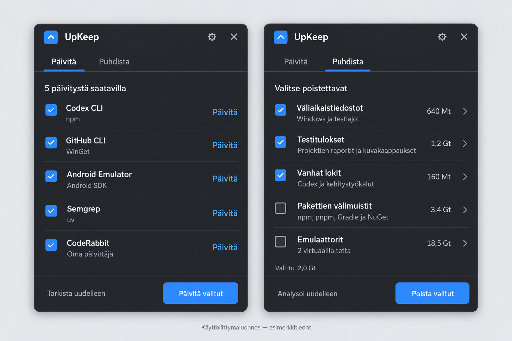

# UpKeep Implementation Plan

> **For agentic workers:** Implement this plan task by task using `superpowers:executing-plans`. Use checkbox steps to record actual progress. Do not start implementation merely because this document exists. Follow the user's project instructions, preserve existing work, and do not commit, push, create a pull request, install updates on the user's machine, or delete user data without the corresponding authorization. Delegation is not required by this plan.

**Goal:** Build a small English-language Windows tray application with exactly two main views, **Updates** and **Cleanup**, that brings the user's installed software update mechanisms and scattered development/test cleanup locations into one simple interface.

**Architecture:** A C# WinUI 3 desktop panel calls a small application core containing explicit update providers, cleanup rules, a process runner, and an operation coordinator. Filesystem inspection and external processes run away from the UI thread. A narrowly restricted, short-lived helper handles only protected system temporary directories when the user requests that operation.

**Tech Stack:** .NET 10, C#, WinUI 3, stable Windows App SDK, Windows Shell/Win32 interoperability, System.Text.Json, and xUnit. Use native controls and standard library functionality before adding dependencies.

**Spec:** This document contains both the product specification and the implementation plan. Sections 1–13 define the product contract; sections 14–17 define implementation, verification, and completion.

**Date:** 2026-10-31, Europe/Helsinki.
**Project root:** `C:\Dev\UpKeep`.
**Document status:** Planning deliverable. No application has been implemented or validated by writing this plan.
**Scope precedence:** The user's latest instructions override earlier brainstorming suggestions and generic skill defaults.

## Global Constraints

- The application name is exactly **UpKeep**.
- All application-owned UI text, accessibility labels, messages, documentation shipped with the app, and source comments are English.
- The two top-level tabs are exactly **Updates** and **Cleanup**.
- No reminders, notifications, scheduled maintenance, automatic updates, automatic deletion, monitoring service, or background maintenance.
- Keep the accepted visual design compact and simple.
- Include the terminal-based update ecosystems actually present on the machine; do not reduce the product to a WinGet-only wrapper.
- Discover installations dynamically. Names, counts, versions, paths, and sizes in the reference image and inventory are examples or dated observations, not application constants.
- Keep project dependencies separate from machine-level tools. Do not rewrite project manifests, lockfiles, Gradle wrappers, target frameworks, or SDK pins through a global maintenance action.
- Never treat a directory named `test`, `tests`, `reports`, `tmp`, or `.codex` as sufficient evidence that its entire contents are disposable.
- Protect source code, credentials, signing material, user documents, Git data, Codex conversations and settings, and active tool installations.
- Analyze before cleanup. Show what will be affected before destructive work begins.
- Never interpret inaccessible or failed inspection as an empty directory, zero bytes, or “Up to date.”
- Never terminate unrelated applications, test runners, emulators, IDEs, package managers, or services.
- The main application runs without administrator privileges. Request UAC only for a selected operation that requires it.
- Keep UpKeep's own runtime data under one known directory. Keep development/test output under the project's `artifacts` directory.
- Do not add an abstraction, dependency, screen, persistent database, setting, or feature unless removing it would prevent the requested outcome or its necessary proof.
- Implementation work must inspect Git state first. If a repository exists on a protected integration branch, switch to a `codex/` feature branch before edits. This document does not authorize commits or pushes.

## Review Focus

These five failure classes are mandatory review targets and are assigned concrete tests below:

1. A cleanup candidate changes between analysis and execution, including a parent being replaced with a junction: skip it and preserve everything outside the validated root.
2. One program is discovered through multiple update routes, while similarly named programs are genuinely separate installations: deduplicate only the same installation, and never update the wrong one.
3. A package manager returns localized, incomplete, changed-format, or unsuccessful output: preserve an explicit unknown/error state instead of inventing successful results.
4. The panel hides, an installer opens another window, cancellation is requested, or UpKeep exits during a batch: preserve the real operation state and do not kill an installer unsafely.
5. Cleanup moves files to the Recycle Bin or removes hard-linked/sparse files: do not misreport logical file size as physically reclaimed disk space.

---

## 1. Product Definition

### 1.1 The problem

The user repeatedly updates development tools through different terminals and manually removes files left by coding agents and test tools. These files accumulate in project directories, Codex directories, AppData, Windows temporary directories, package caches, and Android emulator storage.

UpKeep should remove the need to remember the relevant commands and locations. The main experience should remain as small as the approved image.

### 1.2 The two workflows

**Updates**

1. Open UpKeep.
2. Click **Check for updates**.
3. See supported installed tools and software with their update state.
4. Select individual updates or all currently eligible updates.
5. Click **Update selected**.
6. See which operations succeeded, failed, need interaction, or could not be verified.

**Cleanup**

1. Open **Cleanup**.
2. Click **Analyze**.
3. Review grouped candidates and inspect their exact locations when necessary.
4. Select the files, completed artifact sets, cache actions, or virtual devices to clean.
5. Click **Clean selected**.
6. Review one confirmation describing the selected operations.
7. See completed, skipped, and failed items.

### 1.3 Explicit exclusions

Do not implement:

- A “PC health” score, performance dashboard, RAM optimizer, registry cleaner, or driver updater.
- Reminders, notification badges, toast notifications, schedules, deferred-work queues, or weekly routines.
- An AI chat, account, cloud backend, telemetry, subscription, or remote management.
- A generic custom-command editor or user-supplied script runner.
- An activity/history tab.
- A separate full-screen application or navigation sidebar.
- Automatic installation of missing package managers.
- A global upgrade of every dependency in every project.
- Automatic removal of Codex worktrees, conversations, attachments, generated images, or saved visualizations.
- An automatic Recycle Bin emptying action.
- DISM/SFC repair workflows or Windows component-store cleanup in this release.
- Automatic emulator shutdown, data reset, snapshot deletion, or SDK uninstallation.
- Self-update infrastructure for UpKeep itself in this release.
- ARM64/x86 distributions or Store publication as part of the first local deliverable.

The implementation order below is a build sequence, not permission to call a partial WinGet-only or cleanup-only prototype complete.

## 2. Visual Reference and English UI Contract

### 2.1 Approved image

The user approved the following image as the visual direction. They subsequently required the application to be in English and explicitly said that a new image was unnecessary.

**Project reference copy:** `C:\Dev\UpKeep\docs\design\upkeep-ui-reference.png`.

**Original generated image:** `C:\Users\EmmaH\.codex\generated_images\01a19210-0ec2-7f40-aafa-39c1dfd99b10\exec-341dbaea-c336-4c8e-8b96-1346fc82d6e2.png`.

The project copy is the same generated image, not a newly generated design.

Interpret the reference correctly:

- It shows two states of one window, not two simultaneous application windows.
- Preserve the compact proportions, header, two tabs, simple rows, thin separators, checkboxes, and fixed bottom action area.
- Preserve the understated charcoal/blue visual direction in dark mode.
- The Finnish labels are superseded by the English copy in this plan.
- The five rows are examples, not a fixed maximum or a complete provider list.
- Counts and sizes are illustrative. Do not ship them as real results or prefilled data.
- The checked boxes in the image do not prescribe destructive default selections.
- The blue app mark is a visual direction, not a finished production icon asset.

### 2.2 Window geometry

Use these initial design values:

| Element | Initial value |
|---|---|
| Preferred panel size | 420 × 566 device-independent pixels |
| Outer corner radius | Approximately 12 DIPs, using supported Windows window styling |
| Main horizontal padding | 20 DIPs |
| Header height | Approximately 56 DIPs |
| Tab area | Approximately 44 DIPs |
| Footer | At least 64 DIPs; grows for large text |
| Normal row height | Approximately 64 DIPs; content-driven, not fixed |
| Primary button height | At least 36 DIPs |
| Spacing scale | 4, 8, 12, 16, 20, 24 DIPs |
| Title | Approximately 20 DIPs, semibold |
| Main row text | Approximately 14 DIPs |
| Secondary text | Approximately 12 DIPs, theme-aware |
| Preferred narrow layout | Usable at 360 DIPs width |

These are design defaults, not clipping rules. Clamp the panel to the selected monitor's available work area. If a small work area cannot accommodate the preferred height, reduce the visible list area and keep it scrollable. Never place the footer below the screen.

Use physical-pixel conversions only at the native window boundary. Keep XAML layout in DIPs. Verify mixed-DPI placement rather than assuming 1 DIP equals 1 screen pixel.

### 2.3 Appearance and controls

- Use WinUI theme resources, system typography, native checkboxes, buttons, progress indicators, flyouts, and dialogs.
- Follow the Windows light/dark setting; the dark rendering must closely match the image. High contrast takes priority over decorative colors.
- Do not add a theme selector solely for this release.
- Use top navigation with the standard WinUI control/template appropriate to two items. No left pane, hamburger navigation, closable tabs, or “add tab” button.
- Use one virtualized vertical list per main view. Avoid a ScrollViewer around an already scrolling ListView.
- Rows have separators, not a separate elevated card for every item.
- Keep the footer outside the scrolling list.
- Allow secondary text to wrap where necessary. Full paths appear in details, not as permanently crowded main-row text.
- Use native focus visuals and visible keyboard focus.
- Use subtle native transitions only. Respect reduced-motion settings.
- Do not make translucency, custom acrylic, animated gradients, or shadow matching a release dependency.

### 2.4 Exact English copy

| Reference text or purpose | Application text |
|---|---|
| Päivitä tab | Updates |
| Puhdista tab | Cleanup |
| Initial update action | Check for updates |
| Tarkista uudelleen | Check again |
| Päivitä row action | Update |
| Päivitä valitut | Update selected |
| N päivitystä saatavilla | 1 update available / {count} updates available |
| No supported updates | No updates available |
| Fully verified no-update state | Your supported tools are up to date. |
| Valitse poistettavat | Choose what to clean |
| Initial cleanup action | Analyze |
| Analysoi uudelleen | Analyze again |
| Poista valitut | Clean selected |
| Valittu | Selected: {size} |
| Väliaikaistiedostot | Temporary files |
| Testitulokset | Test artifacts |
| Vanhat lokit | Old logs |
| Pakettien välimuistit | Package caches |
| Emulaattorit | Emulators |
| Oma päivittäjä | Built-in updater |
| Gear button | Settings |
| Close button | Hide UpKeep |
| Details action | Details |
| Clipboard action in details | Copy details |
| No selection | Select at least one item. |
| Busy batch | Working on {current} of {total} |
| Stop queued work | Stop after current |
| Provider with no read-only update check | Check unavailable |
| Provider with a verified updater but no check | Run updater |
| User cancellation | Canceled |
| Locked cleanup file | Skipped: in use |
| Changed cleanup file | Skipped: changed since analysis |
| Protected cleanup location | Administrator access required |
| Incomplete scan | Some locations could not be checked. |
| Interrupted previous operation | The previous operation was interrupted. Check the results before trying again. |

Use English singular/plural forms and English decimal separators. Use **MB** and **GB** with decimal units for the main display, and exact bytes in details. Do not label binary values as decimal units.

Third-party installer output may remain in its original language. Keep all surrounding UpKeep controls and explanations in English.

### 2.5 Header, tray, and settings

Header: app mark and **UpKeep** on the left; Settings and Hide on the right.

Tray behavior:

- Launching the executable shows the panel and registers one notification-area icon.
- Clicking the icon toggles the panel.
- Right-click menu contains only **Open UpKeep** and **Exit**.
- Hiding the panel keeps an already requested operation running.
- Closing the panel does not terminate the application.
- Clicking outside may hide the panel when no UpKeep dialog is open. It must not cancel work or dismiss an installer prompt.
- Recover the tray icon after Explorer restarts.
- Keep the icon registered even if Windows places it in the overflow area. Do not attempt to force the user's taskbar settings.
- Use the icon rectangle when available; otherwise use a monitor work-area fallback.
- Do not add an automatic-start setting in this release.
- A second launch activates the existing instance instead of creating a second runner.

Settings is a small dialog, not a third tab. Its only initial responsibility is managing **Project folders**. Show discovered suggested project roots unchecked; save only the roots the user adds or accepts. On this machine, suggest `C:\Dev` after verifying it exists. Never hard-code that path for other users.

## 3. Verified Starting Point and Inventory

### 3.1 Workspace and toolchain observations

Observed during this planning conversation:

- `C:\Dev\UpKeep` was empty before the planning deliverables and was not a Git repository.
- No existing application architecture or tests need to be preserved inside this project.
- .NET SDKs `10.0.303` and `10.0.403` are installed.
- Windows SDK include directory `10.0.26100.0` exists.
- The `winui` and `xunit` templates are available.
- The installed WinUI template uses `--dotnet-version`, `--target-platform-min-version`, and `--windowsAppSdkVersion`. It does not advertise the unpackaged option described by some older template guides.
- WinGet is `1.29.380`.
- Local `winget list --help` does not advertise a JSON output option. Do not invent `winget list --output json`.
- The Windows version registry reports build `26300.9818`. Its legacy ProductName string says Windows 10; do not infer actual OS capabilities from that string alone.
- Stable `Microsoft.WindowsAppSDK` `2.6.4` and `Microsoft.WindowsPackageManager.ComInterop` `1.29.380` were verified in official package listings on 2026-10-31.

These observations establish a reasonable starting point. They do not prove that a new app builds, launches, or can initialize the WinGet API.

### 3.2 Installed update ecosystems

| Ecosystem | Observed installations | Required treatment |
|---|---|---|
| Windows / WinGet | Numerous registered desktop applications; Git, GitHub CLI, FFmpeg, Gitleaks, Deno, yt-dlp, and others | Discover all matching installed packages; do not maintain a seven-app allowlist. |
| npm | `@nanonets/graft`, `@openai/codex`, `cline`, `firebase-tools`, `greptile`, `pnpm`, `rea-agents` | Enumerate global packages dynamically. |
| pnpm | Installed; no global package dependencies were returned | Include pnpm itself through its installation owner and support packages if subsequently installed. |
| Bun | Installed; empty global package set | Support its own updater and global packages when present. |
| Python manager / pip | Python 3.12 and 3.14; eight packages in the default 3.14 environment | Identify each interpreter and its own package environment. |
| uv | WinGet installation and a pip-installed package were observed; uv-managed Semgrep | Keep distinct physical installations separate; use the correct owner for each. |
| Android | Android CLI, SDK packages, emulator, and two AVDs | Distinguish CLI, SDK packages, emulator executable, system images, and AVD user data. |
| Native CLI tools | Claude Code, CodeRabbit, SonarQube CLI, TruffleHog | Use verified installation-specific update mechanisms. |
| .NET | Two SDKs and several runtimes; no global tools or installed workloads returned | Distinguish SDK/runtime installation ownership from `dotnet tool` packages. |
| Visual Studio | Community and Build Tools installations | Discover through Microsoft's installation metadata; update through the supported installer interface. |
| WSL | Ubuntu, with 545 package-list entries; APT and Snap present | Separate Windows WSL updates from distro package updates. |
| VS Code | Eleven extension directories | Update the editor through its installation owner and extensions through the editor CLI. |
| PowerShell | System modules and package-management modules | Detect separately installed resources; never run blanket updates against built-in OS modules. |

A Python 3.15 registry entry pointed into `C:\Dev\KnitTools-website\Python\pythoncore-3.15-64`, but the executable was not found. Treat stale registrations as diagnostics, not working interpreters.

pnpm's first global-list call failed because its configured global bin directory was absent from PATH. A process-local PATH adjustment allowed listing and returned no global dependencies. UpKeep may adjust a child process's environment for a verified installation; it must not silently modify the user's persistent PATH.

Do not count Windows npm/pnpm/Codex commands inherited through WSL PATH as separate Linux installations.

### 3.3 Storage observations

The following are logical file-size observations from 2026-10-31. Reparse points were skipped. These totals are not promises of reclaimable space, and they are not a persistent baseline.

| Location | Observed logical size | Interpretation |
|---|---:|---|
| 197 recognized output/cache directories under `C:\Dev` | 39.6 GB | Mixed project reports, test outputs, builds, and caches. |
| `C:\Dev\KnitTools\reports` | 14.1 GB | Subset of the previous row; may contain valuable release evidence. |
| `C:\Users\EmmaH\.gradle` | 23.1 GB | Caches, logs, temporary data, JDKs, and distributions. |
| `C:\Users\EmmaH\.android\avd` | 18.5 GB | Two AVDs, including user data and snapshots. |
| `C:\Users\EmmaH\AppData\Local\pnpm\store` | 15.0 GB | Shared content-addressed package storage. |
| `C:\Users\EmmaH\.nuget\packages` | 11.6 GB | Downloaded NuGet packages. |
| `C:\Users\EmmaH\.codex` | 11.2 GB | Mostly retained application state and worktrees, not generic trash. |
| `C:\Users\EmmaH\AppData\Local\npm-cache` | 8.8 GB | Package cache, npx environments, logs, and prebuilds. |
| `C:\Users\EmmaH\.sonar\cache` | 4.5 GB | Analyzer cache. |
| `C:\Users\EmmaH\.cache\codex-runtimes` | 3.8 GB | Current and previous runtimes plus an installation directory. |
| `C:\Users\EmmaH\AppData\Local\Temp` | 2.6 GB | Mixed temporary data, not all attributable to Codex. |
| Codex package `LocalCache` | 2.0 GB | Includes browser data, logs, and tool-specific data. |
| `C:\Users\EmmaH\.m2\repository` | 1.7 GB | Java package storage. |
| `C:\Users\EmmaH\AppData\Local\uv\cache` | 1.3 GB | Python package cache. |
| Android Studio local directories | 1.3 GB combined | Two version-specific IDE directories. |
| `C:\Users\EmmaH\AppData\Local\CrashDumps` | 293 MB | Includes Android emulator and adb crash dumps. |
| `C:\Windows\Temp` | 2.3 MB accessible | Current accessible content only. |

Observed AVDs: `medium_phone` and `ClocklingsReview20261030`. Approximate logical sizes were 12.6 GB and 6.0 GB respectively.

Observed temporary artifacts included `knittools-pr229-smoke-*`, `codex-security-artifacts-*`, `playwright_chromiumdev_profile-*`, `playwright-artifacts-*`, `robolectric-*`, `mockk_boot*.jar`, and `pip-unpack-*`.

Not all `.tmp*` entries were attributable to Codex. An age or naming pattern is not proof of origin.

## 4. Technical Baseline and Delivery Choice

### 4.1 Selected approach

Use **C# + WinUI 3** with an **unpackaged x64 desktop executable**.

This is a planning decision made for this maintenance utility: predictable direct executable launch, explicit local storage, straightforward child-process execution, and a small one-shot elevated helper. The user approved the appearance and behavior, not a specific package format.

Alternatives considered:

| Approach | Tradeoff | Decision |
|---|---|---|
| WinUI 3, unpackaged | Native controls; direct executable and filesystem behavior; explicit runtime deployment required | Selected |
| WinUI 3, MSIX | Convenient package deployment, but package identity/redirected AppData behavior and helper integration require extra care | Not selected for the initial local utility |
| Web/Electron shell | Familiar web UI but another browser runtime and larger maintenance surface for this small tool | Not selected |

The installed template is packaged. Start from its real supported command, then apply Microsoft's documented unpackaged project configuration. Do not pass imaginary template switches.

### 4.2 Version baseline

- Base target: `net10.0-windows10.0.26100.0`.
- Initial supported OS: Windows 11 24H2 or later, x64.
- Windows App SDK package: `Microsoft.WindowsAppSDK` `2.6.4`, verified stable on the plan date.
- WinGet interoperability package: `Microsoft.WindowsPackageManager.ComInterop` `1.29.380`.
- Build SDK starting point: installed `10.0.403`; pin in `global.json` with latest-patch roll-forward within that feature band and prereleases disabled.
- Enable nullable reference types and normal SDK analyzers.
- Use the stable xUnit/test SDK packages selected and verified during scaffold creation; pin them and generate lockfiles.
- Do not add a generic MVVM framework, DI container, ORM, HTTP resilience framework, database, tray-icon framework, or plugin loader.
- Use a small explicit `INotifyPropertyChanged` view model and the application composition root.
- For native interop, use narrow declarations or Microsoft's generated interop if its real necessity is established. Do not copy a large unrelated interop library into the project.

Recheck stable compatibility if implementation starts after the plan date. Update only the selected dependencies and lockfiles; do not upgrade the user's unrelated toolchain.

### 4.3 Deployment

- Development: framework-dependent unpackaged executable with the documented Windows App SDK initialization path.
- Initial deliverable: a tested x64 publish folder and ZIP under `artifacts\publish\win-x64`.
- Publish self-contained .NET and Windows App SDK if the supported release configuration passes launch verification. Do not claim the ZIP is dependency-free without testing its actual runtime requirements.
- Do not add single-file bundling, trimming, or Native AOT to this first release.
- Place the cleanup helper beside the app and include it in publish verification.
- Use an `asInvoker` manifest for the main app.
- Do not install the app, create a startup entry, or add a scheduled task merely as part of a build.
- Signing/distribution credentials are never placed in source control. Public distribution/signing is outside the present implementation acceptance target.

## 5. Updates: Discovery, States, and Execution

### 5.1 Discovery boundaries

Discovery is explicit and read-only with respect to installed software:

- Run only after **Check for updates** or **Check again**.
- Enumerate installed providers, registered tools, package installations, and selected environments.
- It may contact the provider's configured package source to obtain versions.
- It must not install tools, repair PATH globally, accept new legal agreements, elevate, or start an update.
- Do not execute arbitrary PowerShell profile functions to find tools.
- Resolve the real executable or a supported package-manager entry point.
- Inspect user/machine installation registrations and PATH separately from UpKeep's inherited process PATH.
- Exclude Codex-private runtimes from independent host-tool maintenance.
- Use bounded concurrency: at most two independent read-only provider checks; serialize checks sharing the same package store.
- A failed provider does not hide successful results from other providers.

Keep stopped WSL distributions stopped during a global check. Show an explicit **Check Ubuntu** action that explains it will start that distribution. This is an operation consent within the UI, not a reminder. Do not silently terminate a distribution afterward: it may have acquired unrelated work.

### 5.2 Installation identity

Identify an update target by:

- Provider ID.
- Environment ID, such as Windows user scope, machine scope, a particular Python interpreter, or WSL distro.
- Provider-native package ID.
- Installation root or resolved executable identity when available.

Windows path comparisons are case-insensitive; Linux paths are case-sensitive. Display names are not identity keys.

Ownership examples:

- npm-installed Codex CLI and the Codex desktop application are separate products.
- A WinGet-owned Deno executable should not also receive a separate Deno self-update operation in the same batch.
- A Python package named `uv` and a distinct WinGet-installed `uv.exe` may legitimately coexist.
- pnpm installed through npm updates through npm unless inspection establishes a separate self-managed installation.
- VS Code editor and VS Code extensions have different update owners.
- .NET SDKs installed by Visual Studio must follow Visual Studio ownership rather than an indiscriminate uninstall/reinstall.

If ownership is ambiguous, show **Installation source unclear** and disable mutation for that row. Do not resolve ambiguity by preferring whichever executable appears first in the inherited PATH.

### 5.3 Update states

Each item must distinguish:

`Checking`, `UpToDate`, `UpdateAvailable`, `CheckUnavailable`, `UnsupportedInstallation`, `Blocked`, `Queued`, `Running`, `NeedsInteraction`, `SucceededVerified`, `CompletedUnverified`, `Failed`, `Canceled`, and `RestartRequired`.

Rules:

- Unknown latest version is not “Up to date.”
- An updater-only tool may offer **Run updater** after confirming the known command. It is not selected by **Select all updates**.
- An exit code alone is not always sufficient to verify a new version.
- On success, re-query the installed version using the same installation identity.
- If the installer completes but re-query is inconclusive, show **Update finished; version not verified**.
- Preserve package-manager-specific reboot and user-cancel outcomes.
- Do not promise a universal rollback.
- A completed item leaves the eligible-update set; failed items remain available for a deliberate retry.

### 5.4 Provider contract matrix

Commands below define intended provider behavior, not commands to execute while writing or reviewing this plan. Verify their flags and output against the installed supported version before enabling mutation. Capture small sanitized fixtures for parser contracts.

| Provider | Discovery/check approach | Selected update approach |
|---|---|---|
| WinGet | Official WinGet COM interoperability, installed catalog identity, available versions and source metadata | Update the exact catalog package through the supported API; retain its source/scope/pin semantics |
| npm | `npm list --global --depth=0 --json`; `npm outdated --global --json` | Update the exact global package to the reviewed stable target; preserve the correct global prefix |
| pnpm | Installed-version-compatible global list/outdated machine-readable output | Exact selected global package update; update pnpm itself through its installation owner |
| Bun | Global package inventory plus version-compatible outdated metadata | Selected global update or verified Bun self-update, according to ownership |
| pip | For each interpreter: `python -m pip list --format=json` and `python -m pip list --outdated --format=json` | That same interpreter's `-m pip install --upgrade` for the selected package/target |
| uv tools | `uv tool list` and supported tool-version/source metadata | `uv tool upgrade <tool>`; do not globally replace tool version constraints |
| Python manager | Supported interpreter inventory, with actual executable existence checks | Manager-supported update of the selected managed interpreter; preserve separate versions |
| Native CLI updaters | Installed version plus documented read-only check, where available | Verified updater, for example Claude Code, CodeRabbit, or SonarQube CLI |
| Android CLI / SDK | `android sdk list` or the verified legacy entry point; separate CLI version discovery | `android update` for CLI; supported selected SDK package updates for SDK content |
| .NET global tools | `dotnet tool list --global` and supported package-version lookup | `dotnet tool update --global <package-id>` for selected tools |
| .NET SDK/runtime | Installation registration and installer ownership | WinGet or Visual Studio route according to ownership |
| Visual Studio | Microsoft's installation discovery and installer metadata | Supported installer update for the selected instance; no workload additions |
| Windows WSL | Installed WSL version and supported update metadata | Supported Windows WSL updater |
| Ubuntu/APT | Explicit distro activation; read-only installed/upgradable package metadata | Supported selected APT upgrades with dependency changes disclosed |
| Snap | Installed snap inventory and supported refresh-check behavior | Supported selected snap refresh, inside the intended distro |
| VS Code extensions | `code --list-extensions --show-versions`; supported marketplace/update metadata | Supported extension update through the exact editor installation |
| PowerShell resources | Package-managed module/resource inventory and repository metadata | Update the selected separately installed resource; exclude built-in modules |

Do not add Homebrew, Chocolatey, Scoop, Cargo, Conda, Docker, or every imaginable package manager solely because one might be installed later. Current discovery did not establish those as active host ecosystems. Detect unhandled installations and show an honest unsupported state; add a provider when actual user inventory requires it.

For currently observed manually installed tools such as TruffleHog, determine the installation owner before enabling an updater. A tool's existence does not prove a safe self-update command exists.

### 5.5 Parsing and API restrictions

- Prefer structured APIs and documented machine-readable formats.
- Do not implement WinGet discovery by splitting its display table on spaces.
- If a provider only has text output, maintain a version-bounded parser with real fixtures; normalize ANSI sequences and encoding before parsing.
- Reject malformed or ambiguous output as `CheckUnavailable`.
- A nonzero exit can mean “outdated packages exist” for some commands; encode each provider's semantics explicitly.
- Do not compare all versions with `System.Version`. SemVer, PEP 440, Debian, NuGet, and vendor versions differ.
- Let the owning manager determine whether a version is newer and which constraints apply.
- Honor configured sources, release channels, package pins, architecture, installation scope, and environment.
- Do not use `--force`, hash-check bypasses, prerelease opt-ins, broad uninstall flags, or automatic reboot flags.
- Do not automatically accept previously unseen source/package agreements.
- Exclude credentials, source authorization headers, and registry tokens from displayed command details and exported diagnostics.

### 5.6 Update UI and batch semantics

- Initial view: concise empty state and **Check for updates**.
- After checking: updateable rows first; a collapsed **Other tools** group contains up-to-date, unknown, unsupported, and failed-check rows.
- Main row: checkbox, product name, source/environment subtitle, concise status or target version, and individual action.
- Selecting a row is not the same as selecting its checkbox; row details remain keyboard-accessible.
- Default checkboxes are unselected. **Select all updates** selects only verified eligible updates.
- Show current/target versions in details; display them inline only when they fit without crowding.
- Update one selected installation at a time.
- Freeze the execution plan after the user starts the batch.
- Revalidate the installation and target before its update starts.
- Never let an “update all” manager command pull unselected packages into a batch unnoticed.
- Shared dependencies or distro transaction changes must be summarized before execution when the manager can report them.
- If a source cannot restrict a batch to the reviewed selection, represent it as an explicit group operation with its full scope.
- During a batch, show inline progress. Do not create a notification or separate monitoring screen.
- **Stop after current** prevents remaining items from starting. It does not forcibly terminate an active installer.
- Failed unrelated items do not prevent later independent items; authentication/source-wide failures pause the affected provider.
- A modal or external installer prompt is represented as **Needs interaction**.

## 6. Cleanup: Discovery and Candidate Rules

### 6.1 Five visible categories

The main Cleanup list uses the five categories from the visual reference:

1. **Temporary files**
2. **Test artifacts**
3. **Old logs**
4. **Package caches**
5. **Emulators**

A category expands into a same-window details view with a Back action. It is not another top-level tab. Details show source, exact location, size, last modification time, eligibility, and removal method.

Category checkboxes use a true partial-selection state. Selecting a category must not silently include review-required, protected, unknown, or inaccessible items.

All destructive selections start unchecked. The user may explicitly select a known eligible group after analysis.

### 6.2 Location resolution

Resolve current paths from the actual environment, Windows known folders, supported package-manager queries, and installation registrations.

Inspect applicable locations:

| Location family | Examples from this machine | Resolution and boundary |
|---|---|---|
| User temporary directory | `C:\Users\EmmaH\AppData\Local\Temp` | Resolve TEMP/TMP and Windows temporary-path APIs; deduplicate equal physical roots. |
| Other explicitly configured temporary roots | `C:\tmp`, optional `C:\Temp` | Discover existence; do not invent or create them. |
| Windows temporary files | `C:\Windows\Temp`, `C:\Windows\SystemTemp` | Resolve Windows directory; protected locations use the restricted helper. |
| Service temporary files | LocalService and NetworkService Temp directories | Fixed supported roots only; inaccessible results remain explicit. |
| Project roots | User-selected roots, initially suggest `C:\Dev` | Bound traversal to selected roots; discover projects below them. |
| Codex home | `C:\Users\EmmaH\.codex` | Respect CODEX_HOME when set; otherwise current user's `.codex`. |
| Codex desktop AppData | Local/roaming paths and the actual installed package's LocalCache | Resolve package identity dynamically; never hard-code the package-family suffix. |
| Codex runtimes | `C:\Users\EmmaH\.cache\codex-runtimes` | Inventory current/previous/install directories; apply the restricted rules below. |
| Android AVD data | `C:\Users\EmmaH\.android\avd` | Honor ANDROID_AVD_HOME, ANDROID_EMULATOR_HOME, ANDROID_USER_HOME and actual tool metadata. |
| Android SDK | `C:\Users\EmmaH\AppData\Local\Android\Sdk` | Resolve selected SDK; distinguish packages from virtual-device user data. |
| Gradle | User home and project-local `.gradle` | Respect GRADLE_USER_HOME; protect global properties and installed toolchains. |
| npm/npx | Manager-reported cache root | Keep installed global packages separate from cached npx environments. |
| pnpm | Manager-reported store and cache roots | Do not manually recurse-delete content-addressed storage. |
| NuGet | `dotnet nuget locals all --list` | Distinguish temporary/http/plugin caches from global packages. |
| Python | uv/pip cache directories, interpreter-manager downloads | Use the manager's cache query; never mistake environments for caches. |
| Java/Maven | User `.m2\repository` | Review-required downloaded dependencies; preserve settings and credentials. |
| Sonar | User `.sonar\cache` and known temporary/log directories | Preserve authentication, configuration, state databases, and active analyzers. |
| Browser-test data | Temporary Playwright profiles/artifacts and installed test browsers | Temporary runs and downloaded browser installations are separate item types. |
| Crash dumps | Current user's CrashDumps | Metadata inspection only; content is not read. |
| Android Studio | Versioned local IDE cache/log locations | Only documented cache/log subtrees, not an entire IDE profile. |

Do not discover cleanup roots by recursively searching every user's home directory, every installed application, all of AppData, or the entire system drive. The product covers the user's known maintenance ecosystems through explicit location resolvers.

Scan inside selected project roots without reading source contents. File names identifying a project type are normally sufficient. If a project instruction requires scanning a file before reading it, follow that instruction before any content inspection.

### 6.3 Eligibility levels

Every candidate has one of these classifications:

- **Eligible:** a supported, bounded generated-data rule identifies it and execution can revalidate it.
- **Review required:** provenance or retained value is unclear; never included in category-wide selection. The user must inspect and select the individual artifact set.
- **In use:** an owning process, lock, or supported manager indicates active use.
- **Protected:** source, configuration, credentials, user data, or unsupported internal state.
- **Unavailable:** inaccessible, failed to enumerate, or a required manager is missing.

There is no universal “safe to delete” label.

### 6.4 Project artifacts

Recognize project types and generated output separately:

- .NET: known project output `bin`, `obj`, and test-result directories.
- Android/Gradle: module `build`, test reports/results below build output, and project caches.
- Web: known build output, coverage output, Playwright reports/results, and explicitly recognized temporary browser-test artifacts.
- Agent-generated run directories: completed, identifiable output sets under locations such as `reports`, `output`, `artifacts`, and `.native-artifacts`.

Rules:

1. A directory's name is not enough. Associate it with a recognized project and a specific cleanup rule.
2. Do not delete an entire `reports` or `output` root.
3. Enumerate individual artifact sets and their files.
4. Query Git tracked-path metadata per repository without changing the index or worktree.
5. Protect tracked files. Also protect untracked source/test code; “untracked” does not mean disposable.
6. Protect `src`, `tests`, `test`, `androidTest`, source snapshots/golden baselines, scripts, configuration, and documentation unless a more specific generated-output rule proves otherwise.
7. Preserve signing files, credential files, private backups, release candidates, release bundles, and recorded release evidence.
8. APK/AAB/MSIX/ZIP files inside ordinary compiler output can be generated outputs, but a signed/release/evidence artifact set requires individual review.
9. Do not execute a project's build script merely to discover or clean outputs.
10. Do not run `git clean`, `git reset`, or any destructive Git command.
11. For repositories or paths whose status cannot be determined, show **Review required**.
12. Do not infer that an abandoned-looking worktree is disposable.

The large KnitTools reports directory from the inventory is a test case for these rules, not an approved deletion target.

### 6.5 Temporary files and old logs

Use conservative technical defaults without adding a settings maze:

- General temporary files: at least seven days since last modification.
- Known completed test-run artifacts: may be selected individually regardless of age if the rule can establish ownership and no active operation is using them.
- Old application/tool logs: at least fourteen days since last modification, excluding current logs and active database files.
- Crash dumps: at least seven days old and only from the user's selected list.
- Current UpKeep operation files: always excluded from cleanup candidates.
- A future timestamp, missing timestamp, partial scan, or uncertain ownership makes an item review-required or unavailable.

Age thresholds are filters, not proof that data is inactive. Recheck before removal.

For temporary files with an unknown origin, say **Windows temporary files** rather than attributing them to Codex.

Do not read dump, log, report, browser-profile, analytics, or credential contents to calculate sizes.

### 6.6 Codex-specific boundaries

**Potentially supported candidates, after validation:**

- Old closed plaintext logs in the identified Codex log directory.
- Known completed test-tool scratch directories in Windows Temp.
- Documented disposable browser caches, handled separately from browser profile state.
- Clearly identified obsolete runtime installations, but only after an owner/version/active-process check establishes that no current tool points to them.

**Protected by default:**

- `auth.json`, configuration, rules, skills, plugin registrations, automation definitions, and secrets/sandbox credential directories.
- Conversation/session files, memory data, all live SQLite databases and their WAL/SHM companions.
- `worktrees` and any repository checkout.
- `attachments`, `generated_images`, and `visualizations`: these may contain user-requested deliverables, including this plan's original image.
- Current binaries, current runtimes, package dependencies, browser local storage, cookies, and login state.
- Unknown `.tmp` content. The observed `.codex\.tmp` contained plugin/marketplace staging data, not only throwaway scratch files.
- Anything else in a packaged application's LocalCache that belongs to a different tool or contains unrelated application data.

Do not edit Codex configuration to redirect its storage. Do not inspect conversation databases to decide what to delete.

If Codex/browser runtime processes are active and ownership cannot be resolved safely, mark their internal cache candidates **In use**. Do not close Codex.

A directory containing `previous`, `old`, or `install` in its name is only a candidate for investigation. It is not automatically obsolete.

### 6.7 Package cache actions

Prefer supported cache-management commands over arbitrary deletion. Validate the command and its semantics before enabling each action.

| Cache | Initial behavior |
|---|---|
| npm package cache | Show separately from npx environments. Use the documented cache command; explain that future installs may download again. |
| npx environments | Inspect completed cached environments and active ownership separately; never remove a running tool's environment. |
| pnpm store | Use supported pruning; do not delete the entire store or break hard-linked package installations. |
| uv cache | Use supported prune/clean operations; protect active tool environments. |
| pip cache | Use supported cache operations for the intended interpreter/user. |
| NuGet http/temp/plugin caches | Separate supported clear operations. |
| NuGet global packages | Individual review, unselected by default; clearing causes future restore/download work. |
| Gradle caches | Prefer Gradle's documented lifecycle cleanup. Supported manual rules must distinguish recreatable cache data from JDKs, distributions, settings, and active locks. |
| Sonar/Maven downloads | Unselected review-required items until a bounded owner-specific cleanup rule is implemented. |
| Playwright browsers | Installed test dependencies, not temporary profiles. Offer removal only when a supported unused-browser mechanism proves the scope. |

If a cache manager lacks a dry run, do not fabricate an exact list of files it will remove. Show an explicit cache action such as **Prune unused pnpm packages**, with its estimated cache size labeled as informational rather than guaranteed reclaimable space.

Gradle already performs cache maintenance; UpKeep must not fight that lifecycle by deleting all caches after every build. See [Gradle-managed directories and caches](https://docs.gradle.org/current/userguide/directory_layout.html).

### 6.8 Emulators

Show each AVD as an individual selectable item:

- Display name.
- Resolved AVD directory.
- Android/system-image identity when available.
- Running/stopped/unknown state.
- Logical size; allocated size only when measured reliably.
- Clear text: **Removes this virtual device and its data.**

Use the installed Android tooling's supported AVD removal operation after validating its current interface. Do not build a raw `Remove-Item -Recurse` command.

Requirements:

- Never select AVDs automatically.
- Never stop an emulator to make it removable.
- A running or unknown-state AVD is not removable.
- Recheck state immediately before invoking removal.
- Deleting an AVD must not delete a system image shared by another AVD.
- SDK/system-image uninstallation is a separate package action and is outside ordinary **Clean selected**.
- Do not expose snapshot reset or wipe-data commands as a substitute for deletion.
- If the supported AVD tool is unavailable, show **Removal unavailable** with the location; do not fall back to broad filesystem deletion.

## 7. Cleanup Execution and Data Integrity

### 7.1 Analyze → select → confirm → execute

Analysis produces an immutable manifest of the discovered candidates. Selection refers to candidate IDs in that manifest.

The confirmation summarizes:

- Files/artifact sets to move to the Recycle Bin.
- Temporary/cache data to remove permanently through a supported operation.
- AVDs to remove with their data.
- Operations needing administrator access.
- Known exclusions and unavailable items.

Do not silently switch the removal method after confirmation.

A checkbox click alone never starts cleanup. The final **Clean selected** confirmation is the execution authorization.

### 7.2 Path validation

Before accepting a root and again before each direct file operation:

1. Resolve the absolute path with Windows-aware path handling.
2. Reject drive roots, UNC/network paths, device paths, alternate data streams, and unsupported volumes in the initial release.
3. Verify containment by path components and the opened file's final resolved location, not a simple string prefix.
4. Reject `..` escapes and ambiguous relative paths.
5. Inspect reparse points on the candidate and its ancestors. Never follow junctions or symlinks during recursive analysis/removal.
6. Bind the candidate to its volume/file identity where supported.
7. Compare identity, length, and last-write information with the analysis record.
8. If the candidate was replaced, changed, or escaped its root, skip it.
9. Treat permission and sharing failures as item outcomes; do not take ownership or change ACLs.
10. Delete only manifest-listed items. Files created after analysis are not part of the selection.

Do not issue a broad recursive delete against a root just because its children were listed during analysis. Remove validated files first; remove a directory only if it is still the same directory and empty.

Handle symbolic links and hard links separately. A hard-linked file's apparent size is not necessarily reclaimable allocation. Do not count identical physical files twice when presenting allocated-space estimates.

### 7.3 Removal methods

**Project artifacts and user-reviewable files**

Use the Windows Shell Recycle Bin operation through `IFileOperation`. Require recycling and treat any request to fall back to permanent deletion as a declined item. Check per-item callbacks, cancellation, and aggregate aborted status; a successful API call does not mean every item was recycled.

Preserve the OS warning/decision path if a file cannot be recycled. Never combine a silent “yes to all” flag with an implicit permanent-delete fallback.

**Known disposable temporary files**

Permanent deletion is allowed only for the exact validated, selected temporary-file rule and after the confirmation describes it. Do not fall back from a failed recycle operation to this path.

**Managed caches and AVDs**

Use their supported manager operation with the reviewed scope. Report the manager result and re-query state.

### 7.4 Races, locked files, and partial success

- Revalidate directly before the native action.
- Never follow a newly introduced reparse point.
- If the selected directory gains new children, leave those children and the nonempty directory.
- Locked files are skipped; do not retry in a loop or kill the owner.
- A batch can finish with partial success.
- Display counts for completed, skipped, failed, and canceled items.
- Keep individual failure details accessible.
- Do not claim the operation is atomic or that a failed batch rolled back successful earlier removals.
- A cancellation stops scheduling further files; completed native operations remain completed.

### 7.5 Honest size reporting

Separate:

- **Selected size:** logical sizes of selected direct-file candidates.
- **Moved to Recycle Bin:** logical data moved, not freed disk space.
- **Removed:** completed direct removals, still not automatically equal to free-space gain.
- **Cache action completed:** outcome when the manager cannot report exact removed bytes.
- **Observed disk-space change:** optional before/after volume observation, explicitly affected by concurrent activity.

The primary UI may simply say **12 items cleaned, 3 skipped**. Do not add a large “space saved” dashboard.

## 8. Process Execution and Privilege Boundaries

### 8.1 Process runner

All external command execution goes through one runner.

Required behavior:

- Absolute, validated executable path.
- Arguments supplied as an argument list, not concatenated shell text.
- Explicit working directory.
- Explicit small environment overrides where required.
- No PowerShell profile loading for provider execution.
- No command construction from package names or filesystem paths through string interpolation.
- Support Unicode paths, spaces, apostrophes, and shell metacharacters.
- Drain stdout and stderr concurrently.
- Limit retained output to 1 MiB per operation; show that output was truncated.
- Keep current sanitized output in memory by default.
- Read-only probe timeouts are provider-specific; default 60 seconds.
- Mutation timeouts must not forcibly kill an installer. Show a waiting state and allow **Stop after current**.
- Cancellation can terminate only an owned, demonstrably safe read-only probe and its owned children.
- Use the manager's supported cancellation when available for mutations.
- Do not silently retry mutation commands.
- Record actual exit code and provider interpretation separately.
- Installer prompts may be visible when necessary; hidden window is the default for noninteractive probes.
- Never launch a persistent watcher or server.

Prefer a direct executable or the package manager's real script entry point. For a `.ps1` launcher, use a trusted PowerShell executable with `-NoProfile -NonInteractive -File` and separate arguments. For `.cmd` tools, prefer their direct Node/executable entry point; do not interpolate uncontrolled text into `cmd /c`.

### 8.2 Update elevation

Let a supported package API/installer request its normal elevation when possible. Keep the UpKeep main process unelevated.

If a provider cannot report a trustworthy result after an elevated installer handoff, show **Completed; verification required** and perform the provider's post-check. Do not invent captured output from a detached installer.

No permanently elevated update service and no general-purpose “run any command as administrator” helper.

### 8.3 Protected temporary-directory helper

Use a separate minimal executable, `UpKeep.CleanupHost.exe`, only because protected Windows temporary roots are part of the requested scope.

Allowed actions:

- Analyze a fixed supported system temporary root.
- Remove selected, revalidated temporary-file candidates from that same root.

Not allowed:

- Arbitrary absolute cleanup roots supplied by the client.
- Arbitrary commands, package updates, registry edits, ACL changes, or directory ownership changes.
- Other users' profile data.
- Deleting a root directory itself.

Protocol:

- Parent launches the known adjacent helper through UAC for one requested operation.
- Communicate through a local named pipe with an unpredictable name, caller identity restriction, parent PID/start-time verification, and a per-launch nonce.
- The helper resolves allowed root IDs itself; requests contain root IDs and bounded relative candidate data.
- Validate parent identity and every request independently.
- Limit request size and candidate count per message; stream larger reviewed batches in bounded messages.
- Reapply all containment, identity, age, and reparse-point rules in the helper.
- Do not trust a client-provided file ID or timestamp without checking the actual file.
- Denied UAC becomes **Canceled**, not a request to weaken checks.
- If a standard account supplies a different administrator identity, fail closed when the same-user protocol cannot be satisfied.
- Exit after the requested operation or on pipe disconnect. No resident elevated process.
- Do not write reports or payload files to global Windows Temp.

In the normal analysis, protected roots appear as **Administrator access required**. The user explicitly requests **Analyze system temporary files** before the helper is launched.

## 9. State, Storage, and UpKeep's Own Cleanup Discipline

### 9.1 One runtime data root

Use `%LOCALAPPDATA%\UpKeep` for all UpKeep-owned runtime state:

~~~text
UpKeep/
  settings.json
  last-operation.json
  Temp/
    <session-id>/
      cleanup-manifest.jsonl
      <provider-owned transient files, only when required>
~~~

No database is needed.

- `settings.json`: schema version and user-selected project roots only.
- `last-operation.json`: one bounded summary/journal of the current or most recent batch; no history archive.
- `Temp`: owned temporary material that cannot remain in memory.

Write settings and the operation summary atomically within the same directory. Avoid creating repeated timestamped backups.

Do not store full process environments, tokens, cookies, package-source credentials, or raw credential-bearing output.

### 9.2 Large cleanup inventories

The previous inventory includes hundreds of thousands of files. Do not put a UI object around every file.

- Stream filesystem enumeration.
- Aggregate category and artifact-set counts.
- Store the execution manifest as one temporary JSONL file inside the owned session directory when it exceeds the bounded in-memory working set.
- Load details in pages, for example 200 rows at a time.
- Validate that the manifest is inside the current owned session and was not replaced before using it.
- Keep the full per-file manifest immutable after analysis; selection is a separate set of IDs.
- Delete the manifest after the operation or when the analysis is discarded.
- On a later launch, remove only recognized orphaned UpKeep session directories after verifying their owning process is no longer the same running process.
- Do not delete unknown files placed inside UpKeep's data directory by the user.

No scheduled cleanup job is necessary. UpKeep cleans its own completed temporary work as part of that work.

### 9.3 Crash and restart behavior

Before mutation, write the pending batch summary. Update it at item/group boundaries.

On next startup:

- A pending unfinished operation becomes **Interrupted**.
- Do not automatically retry or continue it.
- Recheck affected installation/filesystem state before offering a retry.
- Display the one concise interrupted-operation message within the relevant view.
- Remove stale owned temporary material only after it is no longer needed to explain the result.
- Never infer that interruption means all actions failed or all changes were rolled back.

### 9.4 Diagnostics

Use in-memory per-operation details. **Copy details** copies a sanitized summary after preview.

If the user explicitly exports diagnostics, use a Save dialog and their selected destination. Do not automatically scatter logs, screenshots, HTML reports, or exported JSON around project folders.

The implementation and its tests must follow the same discipline.

## 10. Application Structure and Interfaces

### 10.1 Projects

Use four projects:

1. `UpKeep.App`: WinUI window, view models, tray integration, composition root, Windows Shell UI integration.
2. `UpKeep.Core`: provider orchestration, discovery, cleanup rules, models, process execution, settings, manifests, and shared helper protocol.
3. `UpKeep.CleanupHost`: the restricted short-lived privileged cleanup entry point.
4. `UpKeep.Tests`: focused unit and Windows integration tests.

Do not add a plugin SDK, service project, web project, installer project, or separate data-access layer.

### 10.2 Planned file map

Paths below are relative to `C:\Dev\UpKeep`. These are planned files, not claims that implementation already exists.

~~~text
UpKeep.slnx
global.json
Directory.Build.props
.gitignore
README.md

docs/
  design/upkeep-ui-reference.png
  superpowers/plans/2026-10-31-upkeep-implementation-plan.md

src/
  UpKeep.App/
    UpKeep.App.csproj
    App.xaml
    App.xaml.cs
    MainWindow.xaml
    MainWindow.xaml.cs
    app.manifest
    Assets/UpKeep.ico
    Resources/Strings.resw
    Resources/Theme.xaml
    ViewModels/MainViewModel.cs
    Views/UpdatesView.xaml
    Views/UpdatesView.xaml.cs
    Views/CleanupView.xaml
    Views/CleanupView.xaml.cs
    Views/DetailsView.xaml
    Views/DetailsView.xaml.cs
    Views/SettingsDialog.xaml
    Views/SettingsDialog.xaml.cs
    Platform/TrayIconService.cs
    Platform/PanelPlacement.cs
    Platform/SingleInstanceService.cs
    Platform/RecycleBinService.cs
    Platform/ElevationClient.cs

  UpKeep.Core/
    UpKeep.Core.csproj
    Models/UpdateModels.cs
    Models/CleanupModels.cs
    Models/OperationModels.cs
    Discovery/ToolLocator.cs
    Discovery/InstallationOwnership.cs
    Updates/IUpdateProvider.cs
    Updates/UpdateCoordinator.cs
    Updates/WinGetProvider.cs
    Updates/JavaScriptProvider.cs
    Updates/PythonProvider.cs
    Updates/NativeCliProvider.cs
    Updates/AndroidProvider.cs
    Updates/DotNetProvider.cs
    Updates/WslProvider.cs
    Updates/EditorProvider.cs
    Updates/PowerShellProvider.cs
    Cleanup/CleanupRootResolver.cs
    Cleanup/CleanupAnalyzer.cs
    Cleanup/CleanupPolicy.cs
    Cleanup/CleanupManifest.cs
    Cleanup/PathGuard.cs
    Cleanup/GitProtection.cs
    Cleanup/CleanupExecutor.cs
    Cleanup/CacheActions.cs
    Cleanup/AvdActions.cs
    Processes/ProcessRunner.cs
    Storage/AppPaths.cs
    Storage/SettingsStore.cs
    Storage/OperationJournal.cs
    Elevation/CleanupProtocol.cs

  UpKeep.CleanupHost/
    UpKeep.CleanupHost.csproj
    Program.cs
    ProtectedTempService.cs

tests/
  UpKeep.Tests/
    UpKeep.Tests.csproj
    ProcessRunnerTests.cs
    InstallationOwnershipTests.cs
    ProviderContractTests.cs
    UpdateCoordinatorTests.cs
    CleanupPolicyTests.cs
    PathGuardTests.cs
    CleanupExecutorTests.cs
    CleanupProtocolTests.cs
    StorageLifecycleTests.cs
    PanelPlacementTests.cs
    Fixtures/Providers/<small sanitized output fixtures>

artifacts/
  tests/
  scratch/
  publish/win-x64/
~~~

Retain template-required generated/platform files where needed. Do not duplicate existing generated startup code. Native framework boilerplate is not a reason to build a custom app bootstrap.

Tests may be split further only when a file becomes difficult to understand. The file map is not a requirement to add empty placeholder files.

### 10.3 Shared contracts

Define these public core concepts consistently:

~~~csharp
public readonly record struct InstallationKey(
    string ProviderId,
    string EnvironmentId,
    string PackageId,
    string InstallIdentity);

public interface IUpdateProvider
{
    string Id { get; }

    Task<ProviderCheckResult> CheckAsync(
        DiscoveryContext context,
        CancellationToken cancellationToken);

    Task<UpdateResult> UpdateAsync(
        UpdateRequest request,
        IProgress<OperationProgress> progress,
        CancellationToken cancellationToken);

    Task<VerificationResult> VerifyAsync(
        UpdateRequest request,
        CancellationToken cancellationToken);
}
~~~

`ProviderCheckResult` contains item results, provider status, and sanitized diagnostics. It can represent partial discovery.

`UpdateRequest` contains an `InstallationKey`, the reviewed current/target versions when available, an operation kind, and provider-owned typed metadata. Do not use it as a container for arbitrary shell commands.

`DiscoveryContext` contains resolved host paths, detected installations, selected environments, and a shared process runner.

Define process execution through:

~~~csharp
public interface IProcessRunner
{
    Task<ProcessResult> RunAsync(
        ProcessRequest request,
        IProgress<ProcessOutput>? output,
        CancellationToken cancellationToken);
}
~~~

`ProcessRequest` contains executable, argument list, working directory, limited environment overrides, execution kind, and timeout policy. `ProcessResult` contains exit code, stdout/stderr capture, truncation, cancellation, and start failure information.

Cleanup entry points:

~~~csharp
public Task<CleanupAnalysis> AnalyzeAsync(
    CleanupScope scope,
    IProgress<CleanupProgress> progress,
    CancellationToken cancellationToken);

public Task<CleanupResult> ExecuteAsync(
    CleanupSelection selection,
    IProgress<CleanupProgress> progress,
    CancellationToken cancellationToken);

public PathValidationResult Validate(
    CleanupRoot root,
    CleanupCandidate candidate);
~~~

Assign `AnalyzeAsync` to `CleanupAnalyzer`, `ExecuteAsync` to `CleanupExecutor`, and `Validate` to `PathGuard`.

`CleanupCandidate` records stable ID, root ID, relative path, category, rule ID, logical size, timestamps, identity information, eligibility, removal method, and reason. `CleanupSelection` references a specific analysis manifest and selected IDs/actions; it does not accept arbitrary paths.

UI/OS adapters:

~~~csharp
public interface IRecycleBinService
{
    Task<IReadOnlyList<CleanupItemResult>> RecycleAsync(
        IReadOnlyList<ValidatedCleanupFile> files,
        CancellationToken cancellationToken);
}

public interface IElevatedCleanupClient
{
    Task<ProtectedTempResult> ExecuteAsync(
        ProtectedTempRequest request,
        CancellationToken cancellationToken);
}
~~~

Keep ordinary Windows-native implementation details inside the owning adapter. Instantiate concrete services explicitly in the app composition root. Do not introduce a service locator.

### 10.4 Operation coordination

Allow one mutating batch at a time across both views.

Read-only analysis/checks can be canceled. Disable conflicting analysis while a mutation is executing against the same resources.

The coordinator owns:

- Immutable selected action list.
- Current item and batch progress.
- Provider-specific result mapping.
- **Stop after current** state.
- Last-operation journal.
- Result publication to the UI thread.

The window owns visibility only. Hiding, tab switching, or opening Settings does not own or cancel the batch.

## 11. Accessibility, Responsiveness, and Performance

### 11.1 Accessibility

- Every icon-only button has an English accessible name.
- Checkbox labels include the associated item name; sizes/statuses remain available to screen readers.
- Keyboard users can reach tabs, rows, checkboxes, details, action buttons, and Back.
- Selection and keyboard focus are distinct.
- Status is conveyed through text, not color alone.
- Do not announce every scanned file; announce meaningful phase/result changes.
- Restore focus to the originating row after closing details or confirmation.
- Escape closes a dialog/details first, then hides the panel; it does not silently cancel a mutation.
- High contrast and Windows text scaling must remain usable.
- Use standard accessible WinUI controls instead of drawn text/buttons.

### 11.2 UI performance

- No synchronous filesystem walks or process waits on the UI thread.
- Publish scan progress at a bounded rate, approximately 5 updates per second maximum.
- Use aggregate counts while enumeration continues.
- Keep row collections virtualized.
- Do not read all source contents to identify generated output.
- Do not retain full package dependency trees merely to show global top-level packages.
- Avoid repeated full rescans when switching tabs.
- Idle state has no periodic scanning, timers that poll providers, or persistent child processes.

Performance acceptance is behavioral first: opening, hiding, scrolling, canceling a scan, and switching tabs remain responsive during a large directory walk. Record observed timings and memory during validation; do not invent a performance guarantee from the reference image.

## 12. Failure and Recovery Behavior

| Condition | Required response |
|---|---|
| Package manager not installed | Omit ordinary rows; list unavailable provider in details only if needed for a detected installation. |
| Installed tool has unknown owner | Show unsupported/unclear source; do not guess an updater. |
| Offline or source unreachable | Preserve installed inventory; show check failure, not “Up to date.” |
| Authentication required | Show provider-specific guidance; do not collect/store credentials. |
| Agreement requires acceptance | Show need for interaction; do not automatically accept it. |
| Provider output format changes | Mark check unavailable and retain sanitized diagnostics. |
| Update installer opens UI | Keep batch waiting with “Needs interaction.” |
| Update canceled through UAC | Mark canceled; continue only independent already-authorized items. |
| Package changed since check | Recheck and require a fresh selection if the reviewed operation no longer matches. |
| File changes after analysis | Skip it; require a new analysis. |
| Locked or inaccessible file | Skip/report it; do not weaken permissions. |
| Recycle Bin cannot accept file | Keep original; no automatic permanent deletion. |
| Disk full while saving settings/journal | Preserve existing file and stop before a mutation that cannot be journaled. |
| Cleanup succeeds but summary write fails | Show the actual completed result in memory; do not retry deletion automatically. |
| App crashes during a batch | Mark interrupted on next start; re-query state before any retry. |
| Explorer restarts | Re-register tray icon; preserve operation state. |
| Monitor/DPI changes | Recalculate position and clamp to work area. |
| Exit requested during mutation | Offer “Keep running” or “Stop after current and exit”; do not kill installer. |
| Elevated helper disconnects | Stop further privileged work and exit helper. |
| Another app is using an emulator/cache | Skip affected action; do not close that app. |

## 13. Scope Completeness Rules

The release is not complete merely because the visual shell looks right.

Required coverage:

- Every observed update ecosystem has an implemented discovery path and a verified update path where its installation type supports one.
- An unsupported manually installed tool is explicitly named with its reason; it must not disappear or be shown as current.
- All five cleanup categories are implemented.
- Protected system temporary folders have a controlled elevation path or an explicitly documented remaining blocker.
- Codex-specific cleanup protects conversations, credentials, worktrees, and requested deliverables.
- The app does not make its own scattered-report problem.
- No live user data deletion is required to prove the cleanup engine.
- No real global software update is required to prove the update coordinator.

A provider limitation may be an honest release limitation, but it must remain visible in the final implementation report and cannot be counted as full coverage.

## 14. Implementation Tasks

All tasks below are **not started**. Check a step only after performing it and recording its actual outcome. A task's validation must use controlled fixtures for mutations unless the user separately authorizes a real update or deletion.

Run commands from `C:\Dev\UpKeep` unless a different working directory is explicitly given.

### Task 1: Establish the runnable WinUI baseline

**Files:** solution/build files; the four project files; generated App/MainWindow files; `app.manifest`; initial `README.md`.

**Consumes:** the toolchain observations and version choices in section 4.
**Produces:** a buildable x64 unpackaged WinUI application and a working test project.

- [x] Inspect current directory contents, project instructions, and Git branch/status again. Preserve all existing work.
- [x] Verify installed template help and the selected stable package versions. If the environment now differs, resolve the specific difference before scaffolding.
- [x] Create the WinUI app using the installed template's real flags. The planning-date command shape is:

~~~powershell
dotnet new winui --name UpKeep.App --output src\UpKeep.App --dotnet-version net10.0 --target-platform-min-version 10.0.26100.0 --windowsAppSdkVersion 2.6.4 --UseLatestWindowsAppSDK false
~~~

- [x] Keep one solution at `UpKeep.slnx`; add Core, CleanupHost, and Tests using the installed .NET templates.
- [x] Set the Windows target framework and x64 build configuration consistently. Configure `WindowsPackageType=None` and disable MSIX tooling for the app according to the supported unpackaged configuration. Remove only redundant generated packaging artifacts.
- [x] Retain the supported Windows App SDK automatic initialization path. Do not add a second manual bootstrapper when the generated project already initializes it.
- [x] Add SDK pinning, package lockfiles, nullable settings, and a narrow `.gitignore` for build/test output.
- [x] Build and launch the unpackaged executable. Confirm a responsive visible window titled **UpKeep**, not just a zero process exit code.
- [x] Close only the instance started for this verification.

**Validation:**

~~~powershell
dotnet restore UpKeep.slnx
dotnet build UpKeep.slnx -c Debug -p:Platform=x64
dotnet test tests\UpKeep.Tests\UpKeep.Tests.csproj -c Debug
~~~

Expected: restore/build/test complete successfully and the app launches visibly. Do not install/update Visual Studio or SDKs merely because a generic setup skill suggests doing so; the observed tools are already present unless this verification proves a concrete missing requirement.

### Task 2: Implement the compact shell and tray lifecycle

**Files:** MainWindow, both main Views, DetailsView, SettingsDialog, MainViewModel, Theme, Strings, TrayIconService, PanelPlacement, SingleInstanceService, PanelPlacementTests.

**Consumes:** section 2 UI contract; baseline app.
**Produces:** a functional English two-tab shell using temporary in-memory design fixtures only.

- [x] Add placement tests: `PanelFitsMonitorWorkArea`, `MixedDpiUsesCorrectPixelConversion`, `MissingTrayRectangleUsesFallback`, and `ShortWorkAreaKeepsFooterVisible`.
- [x] Implement a pure placement calculation used by the native positioning adapter.
- [x] Implement the reference composition with native WinUI controls and the exact English copy.
- [x] Implement tray add/remove, click activation, right-click Open/Exit, and recovery after Explorer restart.
- [x] Implement single-instance activation without creating duplicate operation coordinators.
- [x] Implement Settings for selecting project roots and Details with an in-window Back action.
- [ ] Verify hide/show and tab switching do not lose current in-memory state.
- [x] Remove or isolate all demo fixtures from production startup before connecting real providers.

**Validation:** run `dotnet test tests\UpKeep.Tests\UpKeep.Tests.csproj -c Debug --filter FullyQualifiedName~PanelPlacementTests`; manually inspect dark/light/high-contrast rendering and normal/large text. Test Explorer restart only in an isolated Windows test session, not by restarting the user's Explorer without authorization.

### Task 3: Implement process execution and bounded app storage

**Files:** ProcessRunner, AppPaths, SettingsStore, OperationJournal, OperationModels; ProcessRunnerTests; StorageLifecycleTests.

**Consumes:** section 8 execution rules and section 9 storage layout.
**Produces:** `IProcessRunner.RunAsync` and bounded atomic settings/journal services.

- [x] Add tests for arguments containing spaces, Unicode, apostrophes, ampersands, and leading dashes; assert they arrive as data and no extra command executes.
- [ ] Add tests for concurrent stdout/stderr draining, output truncation, nonzero exit, missing executable, probe timeout, and owned-child cancellation.
- [x] Implement explicit executable resolution and process execution without shell-string interpolation.
- [x] Add tests proving a mutation timeout does not kill the process and **Stop after current** does not cancel the active installer.
- [x] Add tests for atomic settings writes, malformed settings fallback without overwrite, full-disk write failure through an injected storage failure, and interrupted journal state.
- [x] Implement owned session directories and cleanup of only recognized orphaned UpKeep scratch files.
- [x] Verify no current-session or unrelated temporary directory can be removed by startup cleanup.

**Validation:** run ProcessRunnerTests and StorageLifecycleTests. All test child processes must exit or be stopped through their retained handles. Do not kill processes by name.

### Task 4: Implement installation discovery and ownership

**Files:** ToolLocator, InstallationOwnership, UpdateModels, IUpdateProvider, InstallationOwnershipTests.

**Consumes:** verified executable/registration locations and the process runner.
**Produces:** stable `InstallationKey` records and owner decisions for provider checks.

- [x] Add fixture tests for npm Codex versus desktop Codex, WinGet Deno versus a separate Deno installation, and two distinct uv installations.
- [x] Add `WslInheritedWindowsCommandIsNotLinuxInstallation`.
- [x] Add `CodexPrivatePowerShellIsNotHostPowerShellOwner`.
- [x] Add `StalePythonRegistrationIsUnavailable`.
- [x] Discover current-user and machine registrations, real executables, relevant package roots, and interpreters.
- [x] Resolve ambiguity explicitly. Do not silently merge equal display names.
- [x] Verify discovery does not execute user profile aliases/functions or alter persistent PATH.

**Validation:** InstallationOwnershipTests pass. A read-only local inventory identifies the known ecosystems without hard-coding the observed package names.

### Task 5: Implement WinGet through structured interoperability

**Files:** WinGetProvider, provider fixtures, ProviderContractTests.

**Consumes:** `InstallationKey`, `IUpdateProvider`, and the installed WinGet service/client.
**Produces:** working structured WinGet discovery, exact-package update planning, and verification.

- [x] Verify the selected official interoperability package exposes the required supported activation and catalog APIs. Follow its actual version's projection/sample setup.
- [ ] Prove API activation from the unpackaged app with a read-only catalog query.
- [ ] Add tests for source identity, user/machine scope, unknown versions, pins, duplicate display names, source failure, and no-update results.
- [x] Implement available-update discovery without parsing the localized display table.
- [x] Implement exact selected-package execution through the supported API, preserving manager cancellation and result codes.
- [x] Implement post-update verification against the same installation.
- [x] Simulate updater results through the provider boundary. Do not update a real user application to complete this task.

**Validation:** provider contract tests pass and a read-only local catalog result matches identifiable installed packages. If the official interop cannot initialize, report that concrete blocker; do not quietly substitute fragile table parsing.

### Task 6: Implement JavaScript and Python update ecosystems

**Files:** JavaScriptProvider, PythonProvider, provider fixtures, ProviderContractTests.

**Consumes:** discovered installation owners and process runner.
**Produces:** npm/pnpm/Bun and interpreter-specific pip/uv/Python-manager discovery and update plans.

- [ ] Capture sanitized installed-version fixtures for supported list/outdated output. Store package names/versions only; no tokens or private registry URLs.
- [x] Test npm's nonzero “updates available” outcome separately from execution failure.
- [x] Test malformed JSON, empty globals, scoped npm names, and a missing configured pnpm bin path.
- [ ] Test two Python interpreters with different packages and the same package name at different versions.
- [x] Implement per-installation checks and stable target plans.
- [x] Preserve uv tool constraints and interpreter/environment identity.
- [ ] Route pnpm/Bun/uv tool self-updates to their actual installation owner.
- [x] Verify commands cannot accidentally run against the current project.
- [x] Verify all selected package identifiers are manager-valid arguments rather than executable fragments.

**Validation:** contract tests cover all six manager families and the Python manager. Read-only checks on this machine should discover the seven npm packages, empty pnpm/Bun global sets, and uv-managed Semgrep. These counts are comparison evidence for the current machine, not test constants for all installations.

### Task 7: Implement native CLI and Android update routes

**Files:** NativeCliProvider, AndroidProvider, provider fixtures, ProviderContractTests.

**Consumes:** discovery/ownership and supported local CLI contracts.
**Produces:** correct native updater actions and separately modeled Android CLI/SDK items.

- [x] Verify Claude Code, CodeRabbit, and SonarQube update/check semantics from installed help and official documentation.
- [x] Implement `CheckUnavailable` plus **Run updater** for an installation that has a verified updater but no read-only latest-version check.
- [x] Do not run an updater during discovery merely to learn whether an update exists.
- [x] Identify TruffleHog's installation origin; enable only a verified update route or display its concrete unsupported reason.
- [x] Verify Android CLI capabilities. The installed sdkmanager already delegates to Android CLI and reports deprecation.
- [x] Implement separate items for Android CLI and installed SDK packages; exclude AVD user data from updates.
- [ ] Add tests for unknown SDK paths, multiple SDK roots, package IDs, emulator updates, and a system image shared by multiple AVDs.
- [x] Ensure update actions never silently accept Android licenses or change project target/compile SDK configuration.

**Validation:** fixtures and simulated operations pass. A real read-only SDK inventory distinguishes the emulator executable from the two AVDs.

### Task 8: Implement .NET, Visual Studio, WSL, editor, and PowerShell coverage

**Files:** DotNetProvider, WslProvider, EditorProvider, PowerShellProvider, provider fixtures, ProviderContractTests.

**Consumes:** installation owners and update-provider contracts.
**Produces:** coverage for the remaining observed update ecosystems.

- [x] Discover .NET global tools separately from SDK/runtime installations and installed workloads.
- [x] Implement selected global-tool updates; route SDK/runtime updates through their actual installer owner.
- [x] Discover Visual Studio instances with Microsoft's supported mechanism and retain exact instance identity.
- [x] Implement the supported Visual Studio update operation without adding workloads.
- [x] Discover WSL distributions and state without starting stopped distros.
- [x] Implement explicit per-distro checks, APT/Snap result parsing, and selected transaction previews.
- [x] Ensure Windows commands inherited by WSL are not treated as Linux package installations.
- [x] Implement VS Code extension inventory and supported updates for the exact editor/profile being managed.
- [x] Discover separately package-managed PowerShell resources and protect built-in modules.
- [ ] Add tests for empty .NET tool lists, an SDK owned by Visual Studio, stopped Ubuntu, WSL UTF-16 output, unavailable sudo/authentication, and extension group operations.

**Validation:** all provider fixtures pass. Real read-only checks are allowed where they do not change the environment. Distro activation must be explicit. No real SDK, distro, extension, or Visual Studio updates are required for this task.

### Task 9: Implement the update coordinator and connect the Updates UI

**Files:** UpdateCoordinator, UpdateCoordinatorTests, MainViewModel, UpdatesView, DetailsView.

**Consumes:** all provider implementations and operation storage.
**Produces:** end-to-end selected update batches with honest outcomes.

- [x] Add tests for serial mutation, duplicate installation rejection, provider failure isolation, changed targets, and explicit updater-only items.
- [ ] Add `HideWindowDoesNotCancelBatch`, `StopAfterCurrentSkipsRemainingItems`, and `InstallerExitWithoutVersionProofIsUnverified`.
- [ ] Add tests for reboot-required and canceled-elevation outcomes.
- [x] Implement immutable batch planning and immediate pre-execution revalidation.
- [x] Bind provider results, selection, details, progress, and post-check outcomes to the UI.
- [x] Ensure **Select all updates** excludes unknown, blocked, unsupported, and updater-only items.
- [x] Persist only the bounded current/last operation summary.
- [ ] Verify with fake providers that the UI never claims the whole machine is up to date while a required provider failed.

**Validation:** UpdateCoordinatorTests pass; manually exercise a simulated mixed-result batch through the real WinUI window.

### Task 10: Implement cleanup roots, classification, and safe manifests

**Files:** CleanupRootResolver, CleanupAnalyzer, CleanupPolicy, CleanupManifest, CleanupModels, GitProtection, CleanupPolicyTests.

**Consumes:** user-selected project roots, actual tool paths, and section 6 rules.
**Produces:** a read-only cleanup analysis with explicit eligibility and an immutable manifest.

- [x] Add fixture trees containing ordinary outputs, tracked reports, untracked source tests, signed release artifacts, credentials, and user documents.
- [x] Assert that `tests`, `androidTest`, `auth.json`, signing material, Codex databases, and worktrees remain protected.
- [x] Add tests for the seven-day temporary filter, fourteen-day log filter, future timestamps, inaccessible roots, and stale paths.
- [x] Implement root discovery without broad scanning of the system drive or other users' profiles.
- [x] Implement project recognition and cached Git tracked-path protection.
- [x] Implement category aggregates and individual artifact-set candidates.
- [x] Implement bounded manifest streaming and paged detail loading.
- [x] Test that canceling analysis closes enumerators and deletes only its owned incomplete manifest.
- [x] Ensure failed enumeration is visibly incomplete and never reported as zero size.

**Validation:** CleanupPolicyTests pass against isolated fixture trees. Run one read-only local analysis only after tests establish protections; do not select/delete real candidates.

### Task 11: Implement direct cleanup and Recycle Bin behavior

**Files:** PathGuard, CleanupExecutor, RecycleBinService, PathGuardTests, CleanupExecutorTests.

**Consumes:** an analysis manifest and explicit selection.
**Produces:** safe direct-file cleanup with per-item results.

- [x] Add path tests for sibling-prefix confusion, `..`, UNC/device/ADS paths, junctions, symlinks, inaccessible parents, and unexpected root replacement.
- [x] Add `AncestorBecomesJunctionAfterAnalyze_IsRejected`, `FileReplacedAfterAnalyze_IsSkipped`, and `NewChildAfterAnalyze_IsPreserved`.
- [ ] Implement handle-informed identity and final-path validation.
- [ ] Implement exact manifest-item execution and empty-directory cleanup without broad recursive root deletion.
- [x] Add Recycle Bin adapter tests that refuse permanent-deletion fallback.
- [ ] Add tests for locked files, partial failure, cancellation, and a hard-linked/sparse-file size result.
- [x] Perform a controlled native Recycle Bin test using only newly created disposable files under the test scratch root.
- [x] Restore or remove those exact test files as appropriate and clean the owned fixture. Do not empty the user's Recycle Bin.

**Validation:** PathGuardTests and CleanupExecutorTests pass. Verify a sentinel outside the fixture root remains unchanged after every traversal/race scenario.

### Task 12: Implement cache actions, Codex rules, and AVD removal

**Files:** CacheActions, AvdActions, CleanupPolicy, cleanup contract fixtures, CleanupExecutorTests.

**Consumes:** owner-specific root resolution and cleanup execution model.
**Produces:** managed cache actions and explicit virtual-device removal plans.

- [ ] Implement supported npm/npx, pnpm, uv, pip, and NuGet cache actions with their real scope.
- [ ] Implement bounded Gradle/log/Sonar/Maven/IDE/browser-cache rules only where provenance and supported semantics are established.
- [x] Keep unsupported cache subtrees visible as review-required/unavailable rather than adding blanket recursive deletion.
- [ ] Add Codex protection tests covering sessions, state databases, WAL/SHM files, worktrees, plugins, current runtimes, attachments, generated images, and visualizations.
- [x] Add tests proving a `previous-*` runtime is not removable solely because of its name.
- [x] Implement AVD discovery and a supported manager deletion plan.
- [ ] Add tests for running/unknown AVD state, an AVD that starts after analysis, and two AVDs sharing a system image.
- [x] Simulate manager mutations; do not prune live caches or delete the user's two AVDs.

**Validation:** cleanup contract tests pass. The real read-only view shows each observed AVD separately and labels installed dependencies distinctly from temporary artifacts.

### Task 13: Implement restricted protected-temp elevation

**Files:** CleanupProtocol, ElevationClient, CleanupHost Program, ProtectedTempService, CleanupProtocolTests.

**Consumes:** fixed supported root IDs and the path/identity rules.
**Produces:** one-shot privileged analysis and cleanup without a general command runner.

- [ ] Add protocol tests for unknown root IDs, absolute paths, traversal, oversized messages, forged parent identity, nonce mismatch, and pipe disconnect.
- [x] Implement parent launch and same-user authenticated local pipe communication.
- [x] Implement helper-side root resolution and independent revalidation.
- [x] Implement UAC denial and unsupported identity-switch results.
- [x] Add tests that arbitrary executables, registry paths, profile roots, and ACL modification requests cannot be represented or executed.
- [ ] Verify helper exit on completion and disconnect.
- [ ] Verify real UAC with analysis only in an authorized Windows test session. A live system-temp deletion is not required.
- [x] Keep an explicit blocker if the elevated handshake cannot be demonstrated safely; do not bypass it by running the entire app as administrator.

**Validation:** protocol tests pass, and no elevated helper remains running after the test.

### Task 14: Connect Cleanup UI, confirmations, and result accounting

**Files:** CleanupView, DetailsView, SettingsDialog, MainViewModel, CleanupExecutorTests, StorageLifecycleTests.

**Consumes:** analyzer, manifest, execution, cache/AVD actions, and elevation client.
**Produces:** the complete Cleanup workflow from section 1.

- [x] Bind the five categories, aggregates, eligibility reasons, paged file details, and tri-state selection.
- [x] Ensure category selection excludes protected, in-use, unavailable, and review-required candidates.
- [x] Implement confirmation text that distinguishes recycling, permanent temporary removal, managed cache actions, and AVD deletion.
- [ ] Add view-model tests for empty selection, mixed removal methods, inaccessible roots, partial success, and discarded analysis.
- [x] Ensure recycled logical bytes are never presented as freed disk space.
- [x] Connect operation coordination so updates and cleanup cannot mutate the same resources concurrently.
- [ ] Verify hiding, tab switching, and external UAC/installer windows preserve work state.
- [ ] Test crash/restart behavior with a controlled journal and fixtures.

**Validation:** simulate a mixed cleanup through the real UI; verify actual native recycling separately with Task 11's fixture only.

### Task 15: Validate appearance, accessibility, and operational behavior

**Files:** existing UI/platform code only as required; one bounded verification record under `artifacts\tests`.

**Consumes:** fully connected application.
**Produces:** evidence that the real app matches the accepted compact design and remains usable.

- [x] Compare a real dark-mode screenshot with the reference. Check composition rather than literal Finnish text or example numbers.
- [ ] Verify all application-owned visible and accessible strings are English.
- [ ] Verify preferred panel size, short work areas, 100%/150%/200% display scaling, Windows text enlargement up to 200%, and mixed-DPI monitors.
- [ ] Verify light and high-contrast modes, keyboard-only operation, and Narrator names/focus order.
- [ ] Test 0, 1, 5, and many rows; long tool names and deep paths; empty/partial/error/busy states.
- [ ] Verify footer actions stay reachable and no horizontal scroll is needed for ordinary content.
- [x] Verify no scheduled tasks, startup entries, reminders, notifications, or background polling are created.
- [ ] Observe idle and large-scan behavior and record actual responsiveness/memory observations.
- [ ] Stop temporary test processes and remove their owned scratch output.

**Validation:** record each actual check and its result. If Narrator, mixed-monitor, or UAC behavior cannot be exercised, report it as unverified, not passed.

### Task 16: Publish, verify, and hand off

**Files:** project publish configuration, README, and `artifacts\publish\win-x64`.

**Consumes:** passing implementation checks.
**Produces:** a usable local x64 application folder/ZIP and a concise known-limitations record.

- [ ] Run the full focused test project once after final changes.
- [ ] Build Release and publish the app/helper with the chosen supported self-contained settings.
- [ ] Verify published helper placement, app icon, English resources, required runtime files, and launch behavior.
- [ ] Launch the published executable, not only the development binary.
- [ ] Verify a real read-only update discovery and cleanup analysis from the published app.
- [ ] Verify published execution does not depend on source-tree paths or the current user's Codex runtime.
- [ ] Confirm provider coverage against section 3.2 and cleanup coverage against section 6.2.
- [x] Document any remaining provider/API/elevation limitations honestly.
- [ ] Check for processes started by this implementation task. Stop temporary ones; leave the application running only if the user wants it left open.
- [x] Report artifact location and actual verification results. Do not commit, push, open a PR, install real updates, or delete real user data as part of handoff.

**Validation commands:**

~~~powershell
dotnet restore UpKeep.slnx --locked-mode
dotnet test tests\UpKeep.Tests\UpKeep.Tests.csproj -c Release
dotnet build UpKeep.slnx -c Release -p:Platform=x64 --no-restore
dotnet publish src\UpKeep.App\UpKeep.App.csproj -c Release -r win-x64 -p:Platform=x64 -p:WindowsPackageType=None -p:WindowsAppSDKSelfContained=true --self-contained true -o artifacts\publish\win-x64
~~~

Configure the app's publish target to include the published helper output. If the generated template requires a documented build-property adjustment, record the actual supported command rather than claiming the example succeeded.

## 15. Test Strategy and Acceptance Matrix

### 15.1 Test levels

**Unit and contract tests**

- Installation ownership.
- Provider parsing and result interpretation.
- Version/target identity handling.
- Update queue and cancellation.
- Cleanup classification and path validation.
- Selection and result accounting.
- Journal/settings lifecycle.
- Elevation message validation.
- Panel placement calculation.

**Controlled Windows integration tests**

- Child-process argument handling and output capture.
- Owned process cleanup.
- File identity/reparse behavior.
- Recycle Bin behavior on disposable files.
- Pipe identity/disconnect behavior.
- WinGet read-only API initialization.
- Actual WinUI launch and tray lifecycle.

**Read-only local checks**

- Installed provider/tool inventory.
- Selected project-root analysis.
- AVD inventory.
- Package cache location resolution.
- Published app checks.

**Separately authorized live checks**

- Updating an actual installed program.
- Clearing a real package cache.
- Removing a real AVD.
- Deleting project artifacts or system temporary files.
- Modifying system installation settings.

Do not make destructive live checks a hidden prerequisite for a passing test suite.

### 15.2 Required test cases

| Area | Mandatory case | Expected result |
|---|---|---|
| Update identity | Same display name, different installations | Separate rows and correct commands |
| Update ownership | Same executable found through two channels | One owner and one update |
| npm | Outdated command returns documented nonzero code | Updates parsed, not generic failure |
| Provider parsing | ANSI/localized/malformed/truncated output | Explicit unavailable/error state |
| Provider network | Timeout/offline/auth failure | Other results remain visible |
| Version checking | Installed version cannot be re-read | CompletedUnverified |
| Execution | Package ID contains shell metacharacters | Rejected or passed as data; no extra command |
| Batch | User hides panel or switches tabs | Work continues correctly |
| Batch | Stop after current | Current item finishes; queued items do not start |
| WSL | Stopped distro | Global check does not start it |
| Android | SDK package versus AVD | Different types and actions |
| Project cleanup | Tracked report and untracked test source | Both protected |
| Codex cleanup | auth/session/db/worktree/generated image | Protected |
| File cleanup | Parent junction introduced after analysis | Skipped; external sentinel preserved |
| File cleanup | File replaced or modified | Skipped |
| Directory cleanup | New file added after analysis | New file retained |
| Locking | Another process holds a file | Skipped, no forced process termination |
| Recycle Bin | Recycling unavailable | Original retained; no permanent fallback |
| Accounting | Recycled/hard-linked/sparse file | No false reclaimed-space claim |
| Cache cleanup | Manager has no exact dry run | Action scope shown without invented file list |
| AVD removal | AVD running or state unknown | Removal blocked |
| Elevation | UAC denied/identity mismatch | Canceled or blocked; no privilege workaround |
| Elevation | Traversal/arbitrary root/unknown action | Rejected |
| Storage | Interrupted atomic write | Previous valid state preserved |
| Storage | Crash before/after one completed item | Honest interrupted/partial result; no automatic retry |
| UI | Large text and short work area | Actions reachable; list scrolls |
| UI | English interface on Finnish Windows | UpKeep text remains English |
| Lifecycle | Second app launch | Existing instance activated |
| App hygiene | Successful/failed/canceled operation | Owned scratch cleaned; unrelated files retained |

### 15.3 Test artifact discipline

- Use `C:\Dev\UpKeep\artifacts\scratch\<test-run-id>` for disposable fixture trees.
- Always validate the resolved scratch path before recursive test teardown.
- Every fixture owns only its subtree and cleans it in `finally`/test disposal.
- Do not use a real project's report directory as a mutation fixture.
- Keep screenshots, if needed for evidence, under `artifacts\tests\ui` with stable descriptive filenames.
- Keep at most the latest verification outputs needed for review.
- Do not create timestamped report trees for every trivial build.
- Do not leave emulator instances, HTTP servers, browser automation profiles, watchers, or helper processes behind.
- Do not run the user's unrelated scanner wrappers or broad project audits.
- Never inspect Numeris analytics or application databases as part of this application work.

## 16. Completion Checklist and Traceability

### 16.1 Product completion

- [ ] Name is UpKeep and the app-owned UI is entirely English.
- [ ] The real app follows the accepted reference image's compact structure.
- [ ] Only Updates and Cleanup are top-level destinations.
- [ ] No reminders, scheduled actions, notification system, or automatic maintenance exists.
- [ ] The tray lifecycle, single instance, hiding, and exit behavior are correct.
- [ ] All observed update ecosystems have explicit implemented coverage or a named, visible remaining limitation.
- [ ] Installation ownership prevents double/wrong updates.
- [ ] Update failures and unavailable checks never appear as “Up to date.”
- [ ] All five cleanup categories work with analysis and reviewed selection.
- [ ] Project source/tests/release evidence and Codex state are protected.
- [ ] Direct cleanup revalidates paths and identities.
- [ ] Recycle Bin behavior and permanent-removal behavior remain distinct.
- [ ] Running AVDs and shared system images are protected.
- [ ] Protected temporary roots use only the restricted elevation route.
- [ ] UpKeep keeps and removes its own temporary files responsibly.
- [ ] Published app and helper launch correctly from their delivery folder.
- [ ] Tests/checks are reported as passed only when actually run.

### 16.2 Requirement-to-task map

| Requirement | Owning tasks |
|---|---|
| English approved compact UI | 2, 15 |
| Correct tray behavior | 2, 15 |
| Safe process execution | 3 |
| One installation, correct updater | 4, 9 |
| WinGet | 5 |
| npm/pnpm/Bun/pip/uv/Python manager | 6 |
| Native CLIs and Android | 7 |
| .NET/Visual Studio/WSL/VS Code/PowerShell | 8 |
| Update batching and verification | 9 |
| Scattered location discovery | 10 |
| Protect source, credentials, and Codex state | 10, 12 |
| Safe direct file cleanup | 11 |
| Cache and emulator management | 12 |
| System-temp elevation | 13 |
| Simple complete cleanup workflow | 14 |
| Accessibility and reference fidelity | 15 |
| Local deliverable and honest handoff | 16 |

### 16.3 Decisions already made by this plan

Do not reopen these merely to add optional complexity:

- C#/WinUI 3.
- Unpackaged x64 initial deliverable.
- .NET 10 and a verified stable Windows App SDK.
- Two main views.
- On-demand checks and analysis.
- No notification/scheduling/history features.
- A single update-provider contract and a bounded cleanup engine.
- No general command/plugin system.
- Native file/tool operations with explicit item results.
- No automatic mutation of project dependencies.

If implementation discovers that a selected platform/API cannot satisfy a required behavior, document the concrete evidence and make the smallest necessary adjustment. A routine implementation detail does not require a new product-design approval cycle.

### 16.4 Remaining technical validation, not unanswered product questions

The following are deliberate early verification work:

- WinGet COM activation/projection setup with the selected version in the unpackaged app.
- Exact machine-readable contracts for installed pnpm/Bun/Python-manager/native-updater versions.
- Exact supported Android AVD removal command in the current Android CLI.
- Safe supported cleanup scope for obsolete Codex runtimes and individual IDE/browser caches.
- Published runtime requirements and helper inclusion.
- Real UAC/same-user helper communication and Recycle Bin behavior.

These are not permission to substitute stubs for working providers or to mark unverified behavior complete.

## 17. Sources and Evidence Boundaries

### 17.1 Official technical references

Use these as implementation references, and recheck version-sensitive commands when implementation begins:

1. [Windows App SDK stable downloads](https://learn.microsoft.com/en-us/windows/apps/windows-app-sdk/downloads) — stable release verification.
2. [Microsoft.WindowsAppSDK package](https://www.nuget.org/packages/Microsoft.WindowsAppSDK/2.6.4) — selected UI package.
3. [Microsoft.WindowsPackageManager.ComInterop package](https://www.nuget.org/packages/Microsoft.WindowsPackageManager.ComInterop/1.29.380) — structured WinGet interoperability.
4. [Unpackaged Windows App SDK deployment](https://learn.microsoft.com/en-us/windows/apps/windows-app-sdk/deploy-unpackaged-apps) — startup/runtime requirements.
5. [Shell_NotifyIcon](https://learn.microsoft.com/en-us/windows/win32/api/shellapi/nf-shellapi-shell_notifyicona) and [Shell_NotifyIconGetRect](https://learn.microsoft.com/en-us/windows/win32/api/shellapi/nf-shellapi-shell_notifyicongetrect) — notification-area integration and anchoring.
6. [IFileOperation](https://learn.microsoft.com/en-us/windows/win32/api/shobjidl_core/nn-shobjidl_core-ifileoperation) and [operation flags](https://learn.microsoft.com/en-us/windows/win32/api/shobjidl_core/nf-shobjidl_core-ifileoperation-setoperationflags) — Shell file operations and their limitations.
7. [WinGet upgrade](https://learn.microsoft.com/en-us/windows/package-manager/winget/upgrade) and [pinning](https://learn.microsoft.com/en-us/windows/package-manager/winget/pinning) — selection, scope, and manager constraints.
8. [npm update](https://docs.npmjs.com/cli/v11/commands/npm-update/) — global versus project package behavior.
9. [uv tools](https://docs.astral.sh/uv/guides/tools/) and [uv cache](https://docs.astral.sh/uv/concepts/cache/) — tool isolation, update constraints, and cache operations.
10. [pnpm store](https://pnpm.io/cli/store) — pruning instead of arbitrary store deletion.
11. [NuGet local resources](https://learn.microsoft.com/en-us/dotnet/core/tools/dotnet-nuget-locals) — distinct cache locations and operations.
12. [Gradle directories and caches](https://docs.gradle.org/current/userguide/directory_layout.html) — cache ownership and lifecycle.
13. [Android environment variables](https://developer.android.com/tools/variables) — SDK/AVD location resolution.
14. [Android CLI](https://developer.android.com/tools/agents/android-cli) and [sdkmanager](https://developer.android.com/tools/sdkmanager) — current CLI and legacy compatibility.
15. [Android emulator snapshots](https://developer.android.com/studio/run/emulator-snapshots) — saved device state, not disposable logs.
16. [VS Code command line](https://code.visualstudio.com/docs/configure/command-line) — editor/extension operations.
17. [WSL commands](https://learn.microsoft.com/en-us/windows/wsl/basic-commands) — distro lifecycle and Windows WSL updates.
18. [Claude Code setup and updates](https://code.claude.com/docs/en/setup) — installation-specific updater behavior.
19. [Codex configuration and state locations](https://learn.chatgpt.com/docs/config-file/config-advanced) — Codex home includes persistent state and credentials.

Do not confuse the old Windows mobile “Windows Package Manager COM API” documentation with modern WinGet interoperability.

### 17.2 Local evidence

The installation and size tables come from read-only commands and metadata inspection performed in this conversation on 2026-10-31. They are not copied from a permanent audit report.

Evidence included:

- Registry/application package inventory.
- Executable discovery.
- npm/pnpm/Bun/uv/pip/.NET local lists.
- WinGet list/help output.
- Android SDK and AVD listings.
- A bounded WSL/Ubuntu package inventory.
- Directory/file metadata enumeration without reading credential, conversation, report, dump, or analytics contents.
- Local SonarQube and CodeRabbit help showing their update commands.

Protected Windows system/service Temp locations were not fully inspectable with the available unelevated permissions. File ownership/provenance could not be established for every arbitrary temporary item.

### 17.3 Final planning boundary

This document and the copied visual reference are the only intended deliverables of the planning request.

No application scaffolding, dependency installation, code implementation, real software updates, user-data cleanup, repository initialization, commits, pushes, or pull requests are authorized merely by saving this plan.

